# FLOW — `<Project Name>`

> **How to use this template**
> 1. Copy this file into the project root and rename it to `FLOW.md`.
> 2. Replace every `<placeholder>` with a real value. Search for `<` to find any you missed.
> 3. Delete any section that doesn't apply, such as **Database Flow** for a stateless service. Don't leave empty headings.
> 4. Keep the Mermaid diagrams in step with the code. A diagram that's out of date is worse than none.
> 5. Delete this box when you're done.

| Field | Value |
|---|---|
| **Owner** | `<team / person>` |
| **Last updated** | `<YYYY-MM-DD>` |
| **Status** | `<draft · active · deprecated>` |
| **Repo** | `<url>` |
| **Related docs** | `<README, ADRs, API spec, runbook>` |

---

## Table of Contents

1. [Project Overview](#1-project-overview)
2. [Architecture](#2-architecture)
3. [Directory Structure](#3-directory-structure)
4. [Database Flow](#4-database-flow)
5. [CRUD Operations](#5-crud-operations)
6. [Function Flow](#6-function-flow)
7. [API Flow](#7-api-flow)
8. [Error Handling Flow](#8-error-handling-flow)
9. [Testing](#9-testing)
10. [Deployment](#10-deployment)
11. [Configuration & Environment](#11-configuration--environment)
12. [Glossary & Decisions](#12-glossary--decisions)

---

## 1. Project Overview

### What it does (one line)

`<Given X, the system does Y for Z users.>`

### Problem it solves

`<Two or three sentences. Who has the problem, and what they did before this existed.>`

### Scope

| In scope | Out of scope |
|---|---|
| `<feature>` | `<thing people might assume it does, but it doesn't>` |
| `<feature>` | `<...>` |

### Tech stack

| Layer | Technology | Version | Why this choice |
|---|---|---|---|
| Language | `<Python / TypeScript / Go>` | `<x.y>` | `<reason>` |
| Framework | `<FastAPI / Express / Spring>` | `<x.y>` | `<reason>` |
| Database | `<PostgreSQL / MongoDB / none>` | `<x.y>` | `<reason>` |
| ORM / driver | `<SQLAlchemy / Prisma>` | `<x.y>` | `<reason>` |
| Cache / queue | `<Redis / RabbitMQ / none>` | `<x.y>` | `<reason>` |
| Hosting | `<AWS / GCP / Render / on-prem>` | — | `<reason>` |

### Key terms

| Term | Meaning in this project |
|---|---|
| `<Entity>` | `<definition>` |

---

## 2. Architecture

### Style

`<Monolith / layered / hexagonal / microservices / serverless>`. Why: `<reason>`.

### System context: who talks to the system

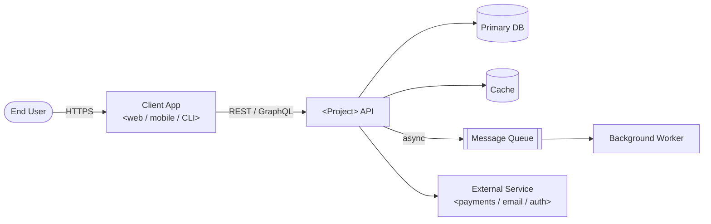

### Layers: who is allowed to call whom

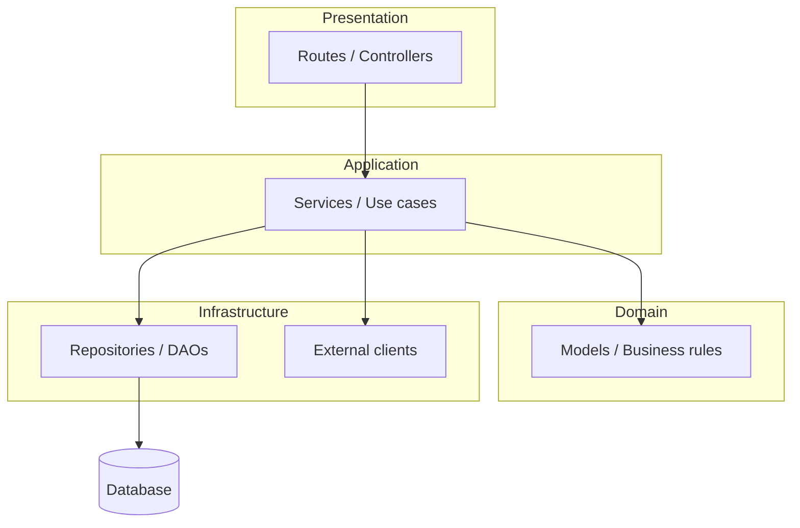

**The rule:** calls only go down. A route never talks to the database directly. `<State any exceptions and why they exist.>`

### Components

| Component | Responsibility | Depends on | Owned by |
|---|---|---|---|
| `<routes>` | HTTP in and out, status codes | services | `<team>` |
| `<services>` | business logic, orchestration | repositories, models | `<team>` |
| `<repositories>` | persistence | DB driver | `<team>` |

---

## 3. Directory Structure

```text
<project-root>/
├── <src|app>/
│   ├── main.<ext>            # entry point, app wiring
│   ├── routes/               # HTTP layer
│   ├── services/             # business logic
│   ├── models/               # schemas / entities
│   ├── repositories/         # DB access
│   ├── exceptions/           # custom errors + handlers
│   └── config.<ext>          # settings loaded from env
├── tests/
│   ├── unit/
│   ├── integration/
│   └── e2e/
├── migrations/
├── Dockerfile
├── .env.example
└── README.md
```

| Path | What goes here | What must **not** go here |
|---|---|---|
| `routes/` | request parsing, response shaping | SQL, business rules |
| `services/` | rules, orchestration | HTTP objects, raw SQL |
| `repositories/` | queries | HTTP concerns |

---

## 4. Database Flow

### Entity-relationship diagram

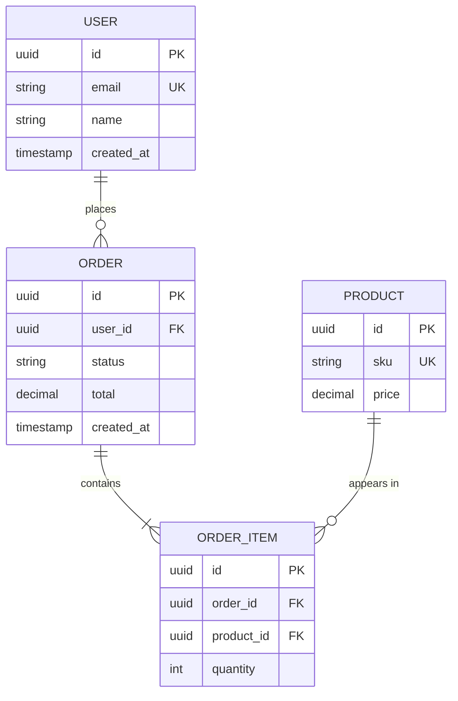

> Replace the example entities above with your own.

### Tables / collections

| Table | Purpose | Key columns | Indexes | Approx. rows |
|---|---|---|---|---|
| `<users>` | `<purpose>` | `id`, `email` | `email (unique)` | `<n>` |

### Data lifecycle

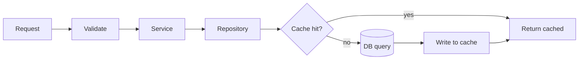

### Transactions & consistency

- **Transaction boundary:** `<per request / per service method / explicit unit of work>`
- **Isolation level:** `<READ COMMITTED / SERIALIZABLE>`
- **Concurrency control:** `<optimistic locking with version column / row locks / none>`
- **Soft or hard delete:** `<which, and why>`

### Migrations

| Tool | Create a migration | Apply | Roll back |
|---|---|---|---|
| `<Alembic / Flyway / Prisma>` | `<command>` | `<command>` | `<command>` |

---

## 5. CRUD Operations

Fill in one table per resource.

### Resource: `<Resource>`

| Operation | HTTP | Endpoint | Service function | Repository function | Success | Common errors |
|---|---|---|---|---|---|---|
| Create | `POST` | `/<resources>` | `create_<resource>()` | `insert()` | `201` | `400`, `409`, `422` |
| Read one | `GET` | `/<resources>/{id}` | `get_<resource>()` | `find_by_id()` | `200` | `404` |
| Read list | `GET` | `/<resources>?page=&limit=` | `list_<resources>()` | `find_all()` | `200` | `400` |
| Update | `PUT` / `PATCH` | `/<resources>/{id}` | `update_<resource>()` | `update()` | `200` | `404`, `409`, `422` |
| Delete | `DELETE` | `/<resources>/{id}` | `delete_<resource>()` | `delete()` | `204` | `404` |

### Create: sequence

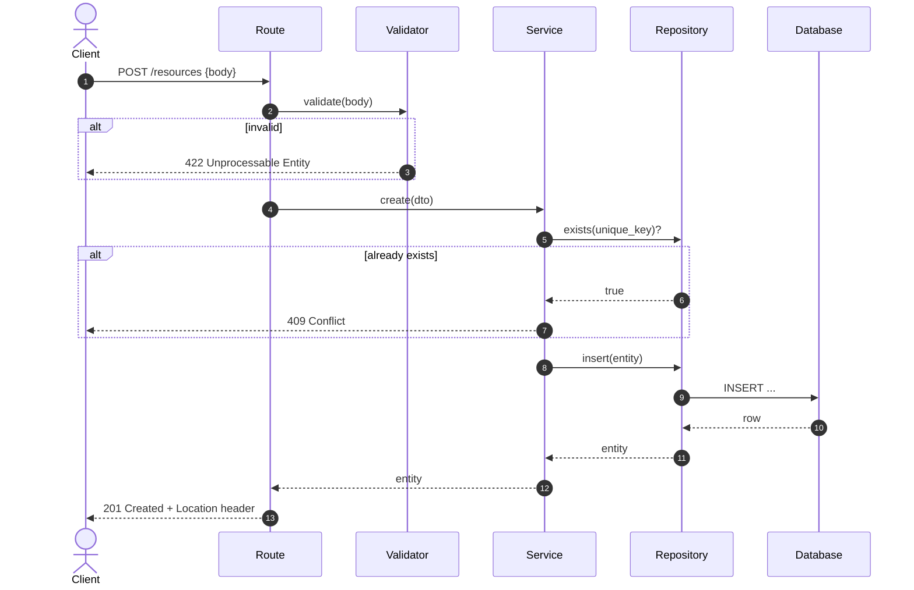

### Read, update, delete: rules

- **Read:** `<pagination style (offset / cursor), default and max page size, allowed filters and sort fields>`
- **Update:** `<PUT replaces the whole resource and PATCH changes some fields; which one is supported and how conflicts are detected>`
- **Delete:** `<soft or hard; cascade behaviour; whether it is idempotent>`

---

## 6. Function Flow

### Main call chain

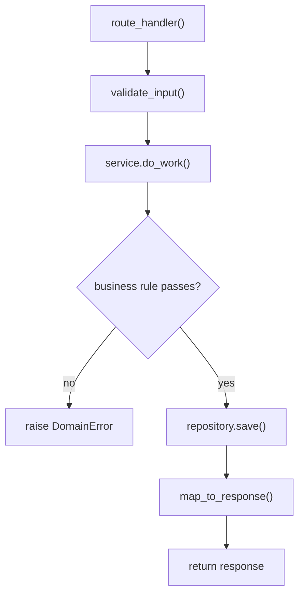

### Key functions

| Function | File | Input | Output | Side effects | Raises |
|---|---|---|---|---|---|
| `<name>()` | `<path>:<line>` | `<type>` | `<type>` | `<DB write / email / none>` | `<ErrorType>` |

### Function walkthrough: `<critical_function>()`

1. `<Step: what it checks or computes, and why>`
2. `<Step>`
3. `<Step>`

**Invariant:** `<something that is always true when this function returns>`

### Background jobs / async flow (if any)

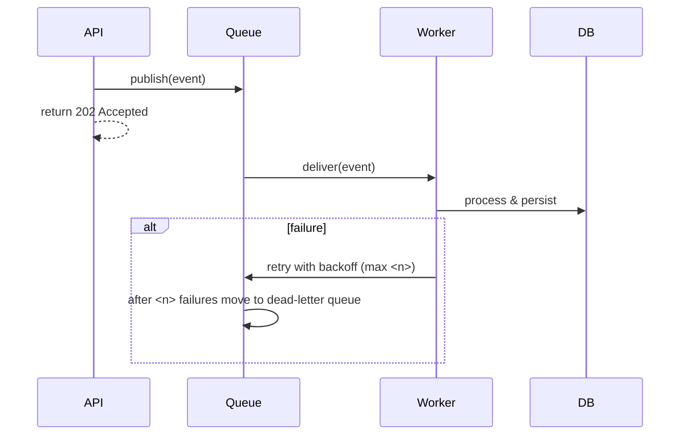

---

## 7. API Flow

### Request lifecycle

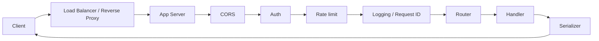

### Authentication & authorization

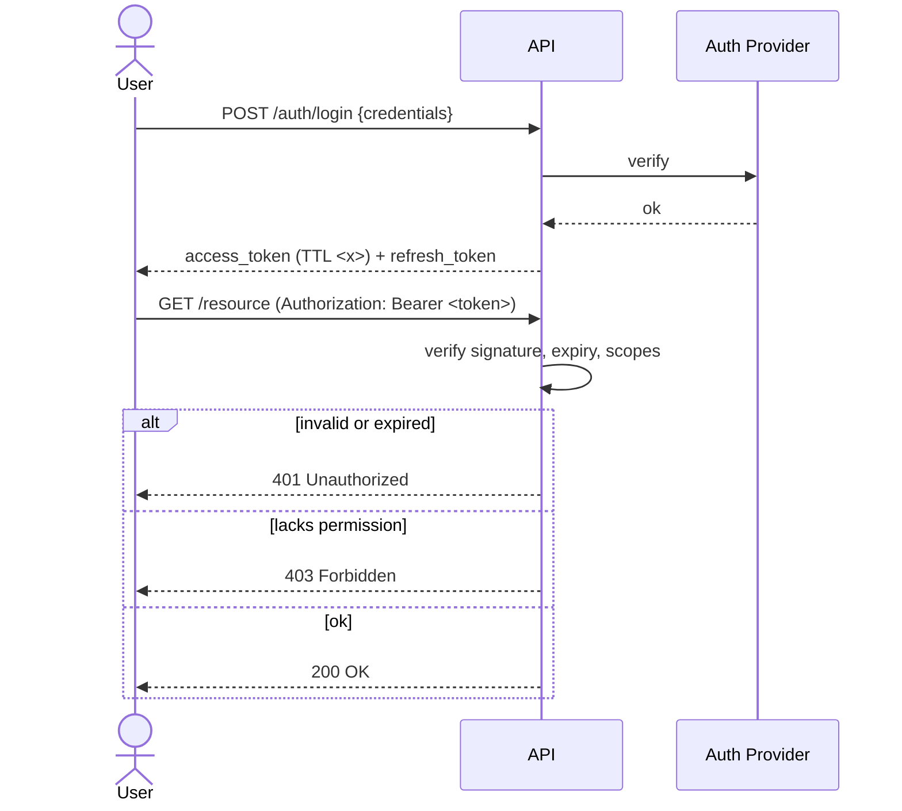

- **Scheme:** `<JWT / session cookie / API key / OAuth2>`
- **Roles and permissions:** `<role → allowed actions>`

### Endpoint reference

| Method | Path | Auth | Request body | Response | Status codes |
|---|---|---|---|---|---|
| `GET` | `/health` | none | — | `{status}` | `200` |
| `<METHOD>` | `<path>` | `<role>` | `<schema>` | `<schema>` | `<codes>` |

### Example request and response

```http
POST /<resources> HTTP/1.1
Content-Type: application/json
Authorization: Bearer <token>

{ "<field>": "<value>" }
```

```json
{
  "id": "<uuid>",
  "<field>": "<value>",
  "created_at": "<ISO-8601>"
}
```

### Conventions

- **Versioning:** `<URL prefix /v1 / header / none>`
- **Naming:** `<plural nouns, kebab-case paths, snake_case fields>`
- **Pagination envelope:** `<{ items, total, page, limit } / cursor>`
- **Timestamps:** `<ISO-8601 UTC>`
- **Rate limits:** `<n requests per window, per key or IP>`

---

## 8. Error Handling Flow

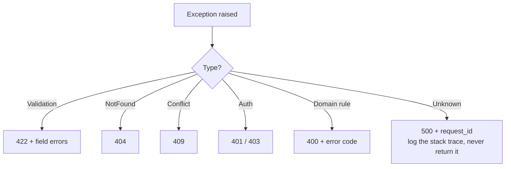

### Error response shape

```json
{
  "error": {
    "code": "<MACHINE_READABLE_CODE>",
    "message": "<Human readable>",
    "details": [],
    "request_id": "<id>"
  }
}
```

| Error class | HTTP | Code | When it's raised |
|---|---|---|---|
| `<NotFoundError>` | `404` | `<RESOURCE_NOT_FOUND>` | `<condition>` |

---

## 9. Testing

### Test pyramid

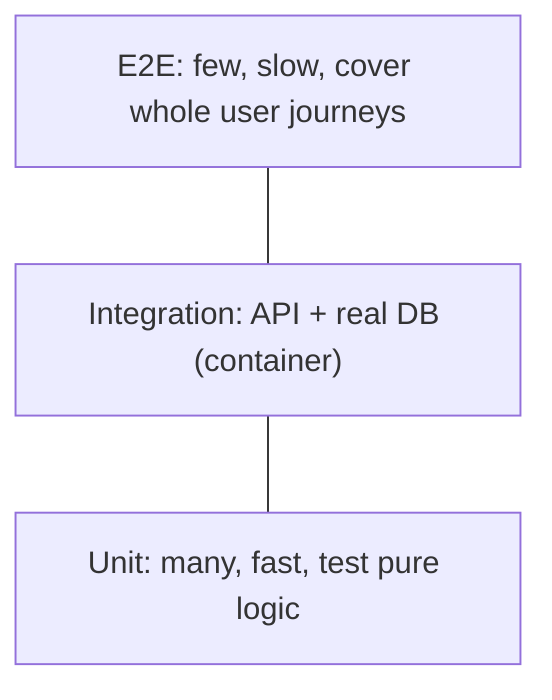

| Level | Tool | Location | What it covers | Command |
|---|---|---|---|---|
| Unit | `<pytest / jest>` | `tests/unit/` | services, validators, pure functions | `<cmd>` |
| Integration | `<pytest + testcontainers / supertest>` | `tests/integration/` | routes, repositories, DB | `<cmd>` |
| E2E | `<Playwright / Postman / k6>` | `tests/e2e/` | full user flows | `<cmd>` |
| Load | `<k6 / Locust>` | `tests/load/` | throughput and latency targets | `<cmd>` |

### What every endpoint must be tested for

- [ ] Happy path returns the documented status and response shape
- [ ] Invalid input returns 422 or 400 with field-level errors
- [ ] Missing resource returns 404
- [ ] Unauthenticated returns 401, and unauthorized returns 403
- [ ] Duplicate or conflict returns 409 (for create and update)
- [ ] Boundary values (empty, max length, max list size)
- [ ] Idempotency (PUT, DELETE, retries)

### Test data & fixtures

- **Fixtures:** `<where they live, factory library used>`
- **DB isolation:** `<transaction rollback per test / fresh schema / containers>`
- **External services:** `<mocked with ... / sandbox accounts>`

### Coverage

- **Target:** `<e.g. 80% lines, 100% on services/>`
- **Command:** `<cmd>`

---

## 10. Deployment

### Pipeline

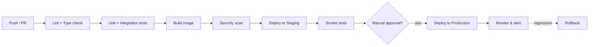

### Environments

| Environment | URL | Branch / trigger | Database | Notes |
|---|---|---|---|---|
| Local | `http://localhost:<port>` | — | `<local / docker>` | |
| Staging | `<url>` | `<main / tag>` | `<staging DB>` | |
| Production | `<url>` | `<tag / release>` | `<prod DB>` | |

### Infrastructure

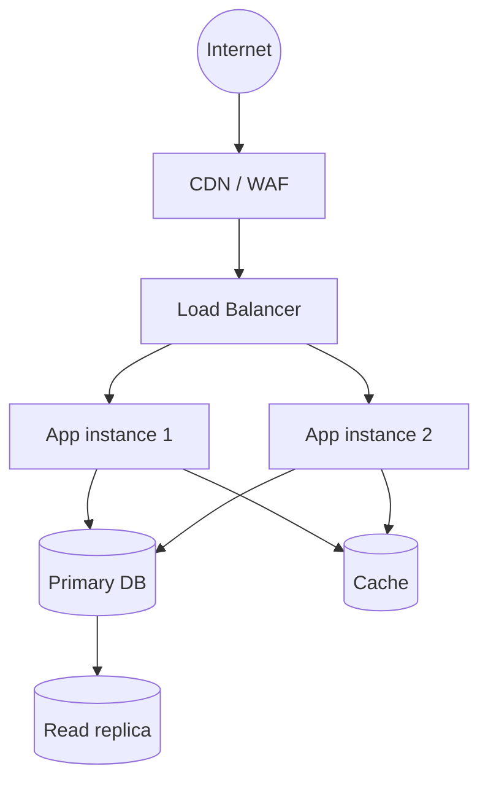

### Run locally

```bash
<clone command>
cp .env.example .env
<install dependencies command>
<run migrations command>
<start command>
```

### Release & rollback

- **Release strategy:** `<rolling / blue-green / canary>`
- **Rollback:** `<command or steps>`
- **Migrations during deploy:** `<run before deploy; must be backward-compatible>`

### Observability

| Concern | Tool | Where to look |
|---|---|---|
| Logs | `<tool>` | `<link>` |
| Metrics | `<tool>` | `<dashboard link>` |
| Traces | `<tool>` | `<link>` |
| Alerts | `<tool>` | `<on-call channel>` |
| Health check | — | `GET /health` |

---

## 11. Configuration & Environment

| Variable | Required | Default | Description |
|---|---|---|---|
| `DATABASE_URL` | yes | — | `<connection string>` |
| `SECRET_KEY` | yes | — | `<used for signing tokens>` |
| `LOG_LEVEL` | no | `INFO` | `<level>` |
| `<VAR>` | `<yes/no>` | `<default>` | `<description>` |

**Secrets** are stored in `<vault / cloud secret manager / CI secrets>`. They are never committed to the repo.

---

## 12. Glossary & Decisions

### Architecture decisions

| # | Decision | Alternatives considered | Why | Date |
|---|---|---|---|---|
| 1 | `<Chose X>` | `<Y, Z>` | `<reason>` | `<YYYY-MM-DD>` |

### Known limitations & tech debt

- `<limitation, and the conditions under which it becomes a problem>`

### Open questions

- `<question>`: owner `<name>`
