# {{PROJECT_NAME}} — Project Flow

> **How to use this template**
> 1. Copy this file into your project root as `FLOW.md`.
> 2. Replace every `{{PLACEHOLDER}}` with real values.
> 3. Delete sections that don't apply. Don't leave empty headings.
> 4. Edit the Mermaid diagrams to match your system. They render on GitHub, GitLab, VS Code (with a Mermaid extension) and most docs sites.
> 5. Update this file whenever architecture, schema or API contracts change.

| Field | Value |
|---|---|
| **Version** | {{1.0.0}} |
| **Last updated** | {{YYYY-MM-DD}} |
| **Owner(s)** | {{Name / Team}} |
| **Repository** | {{repo URL}} |
| **Status** | {{Draft / Active / Deprecated}} |

---

## Table of Contents

1. [Project Overview](#1-project-overview)
2. [Tech Stack](#2-tech-stack)
3. [Directory Structure](#3-directory-structure)
4. [Architecture](#4-architecture)
5. [Database Flow](#5-database-flow)
6. [CRUD Operations](#6-crud-operations)
7. [Function Flow](#7-function-flow)
8. [API Flow](#8-api-flow)
9. [Authentication & Authorization](#9-authentication--authorization)
10. [Error Handling](#10-error-handling)
11. [Testing](#11-testing)
12. [Deployment](#12-deployment)
13. [Configuration & Environment](#13-configuration--environment)
14. [Monitoring & Logging](#14-monitoring--logging)
15. [Glossary](#15-glossary)
16. [Changelog](#16-changelog)

---

## 1. Project Overview

### 1.1 Purpose
{{One or two sentences on what the project does and the problem it solves.}}

### 1.2 Target Users
- {{User type 1}}: {{what they do with the system}}
- {{User type 2}}: {{what they do with the system}}

### 1.3 Core Features
| # | Feature | Description | Status |
|---|---|---|---|
| 1 | {{Feature}} | {{Short description}} | {{Done / In progress / Planned}} |
| 2 | {{Feature}} | {{Short description}} | {{…}} |

### 1.4 Scope
- **In scope:** {{…}}
- **Out of scope:** {{…}}

### 1.5 High-Level User Journey

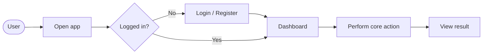

---

## 2. Tech Stack

| Layer | Technology | Version | Notes |
|---|---|---|---|
| Frontend | {{React / Vue / HTML+JS}} | {{x.y}} | {{…}} |
| Backend | {{FastAPI / Express / Django / Spring}} | {{x.y}} | {{…}} |
| Database | {{PostgreSQL / MySQL / SQLite / MongoDB}} | {{x.y}} | {{…}} |
| ORM / ODM | {{SQLAlchemy / Prisma / Mongoose}} | {{x.y}} | {{…}} |
| Cache | {{Redis / none}} | {{x.y}} | {{…}} |
| Queue | {{Celery / RabbitMQ / Kafka / none}} | {{x.y}} | {{…}} |
| Auth | {{JWT / OAuth2 / Session}} | — | {{…}} |
| Testing | {{pytest / Jest / JUnit}} | {{x.y}} | {{…}} |
| CI/CD | {{GitHub Actions / GitLab CI / Jenkins}} | — | {{…}} |
| Hosting | {{AWS / GCP / Azure / Render / VPS}} | — | {{…}} |

---

## 3. Directory Structure

```text
{{project-root}}/
├── {{src or app}}/
│   ├── main.{{ext}}          # Entry point
│   ├── config.{{ext}}        # Settings / env loading
│   ├── database.{{ext}}      # DB connection / session
│   ├── models/               # ORM models (tables)
│   ├── schemas/              # Request/response validation
│   ├── routes/               # API endpoints (controllers)
│   ├── services/             # Business logic
│   ├── repositories/         # Data-access layer (optional)
│   └── utils/                # Helpers
├── frontend/                 # UI code (if any)
├── tests/                    # Unit / integration / e2e tests
├── migrations/               # DB migrations
├── .env.example              # Sample environment variables
├── Dockerfile
├── docker-compose.yml
├── requirements.txt | package.json
└── README.md
```

| Folder / File | Responsibility |
|---|---|
| `{{path}}` | {{what lives here}} |

---

## 4. Architecture

### 4.1 Architectural Style
{{Monolith / Layered / Microservices / Serverless / Event-driven}}, chosen because {{reason}}.

### 4.2 System Context

```mermaid
flowchart TB
    user([End User])
    admin([Admin])
    subgraph System["{{PROJECT_NAME}}"]
        fe[Frontend]
        api[Backend API]
        db[(Database)]
        cache[(Cache)]
        worker[Background Worker]
    end
    ext1[[External Service: {{e.g. Payment / Email}}]]

    user --> fe
    admin --> fe
    fe -->|HTTPS / JSON| api
    api --> db
    api --> cache
    api -->|enqueue job| worker
    worker --> db
    api --> ext1
```

### 4.3 Layered Architecture

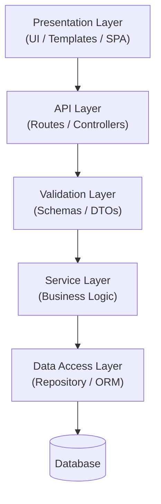

| Layer | Responsibility | Must NOT do |
|---|---|---|
| Routes | Parse HTTP, call service, return response | Contain business logic or raw SQL |
| Schemas | Validate and serialize data | Talk to the DB |
| Services | Business rules, orchestration | Know about HTTP |
| Repository / ORM | Read/write persistence | Contain business rules |

### 4.4 Key Design Decisions

| # | Decision | Alternatives considered | Reason |
|---|---|---|---|
| ADR-1 | {{e.g. Use PostgreSQL}} | {{MySQL, MongoDB}} | {{…}} |

---

## 5. Database Flow

### 5.1 Connection Lifecycle

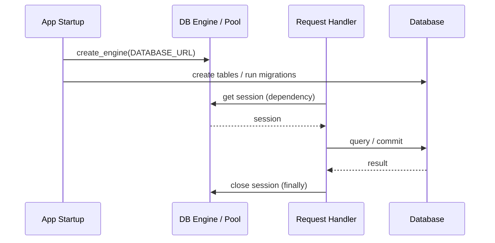

### 5.2 Entity Relationship Diagram

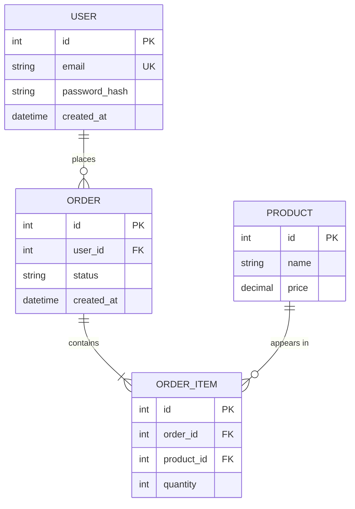

> Replace the sample entities above with your own.

### 5.3 Table Reference

#### `{{table_name}}`
| Column | Type | Constraints | Description |
|---|---|---|---|
| `id` | {{INTEGER}} | PK, auto-increment | Primary key |
| `{{column}}` | {{VARCHAR(255)}} | {{NOT NULL, UNIQUE}} | {{…}} |
| `created_at` | {{TIMESTAMP}} | default now() | Creation time |

**Indexes:** {{idx_name (columns)}}
**Relationships:** {{e.g. many-to-one with `users`}}

### 5.4 Migrations
- Tool: {{Alembic / Prisma Migrate / Flyway / Django migrations}}
- Create: `{{command}}`
- Apply: `{{command}}`
- Roll back: `{{command}}`

---

## 6. CRUD Operations

### 6.1 CRUD Matrix

| Resource | Create | Read (list) | Read (one) | Update | Delete |
|---|---|---|---|---|---|
| {{Resource}} | `POST /{{res}}` | `GET /{{res}}` | `GET /{{res}}/{id}` | `PUT/PATCH /{{res}}/{id}` | `DELETE /{{res}}/{id}` |

### 6.2 Create

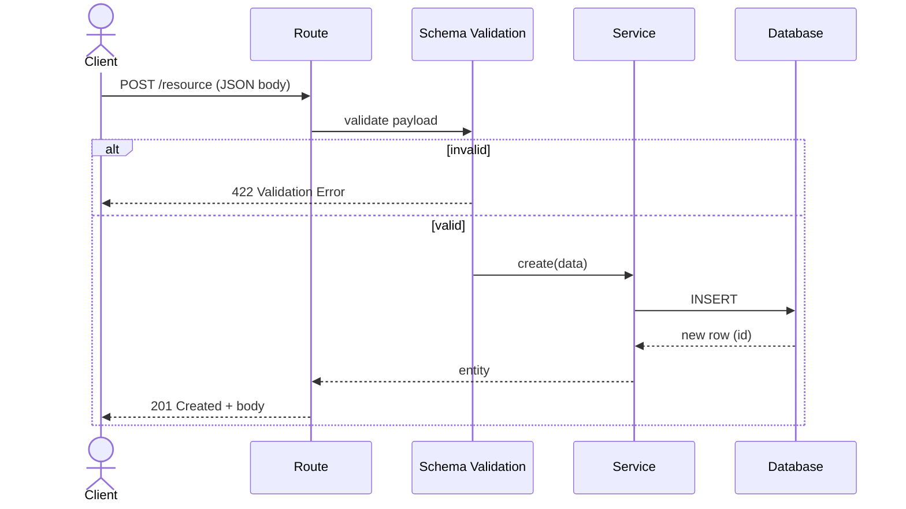

### 6.3 Read

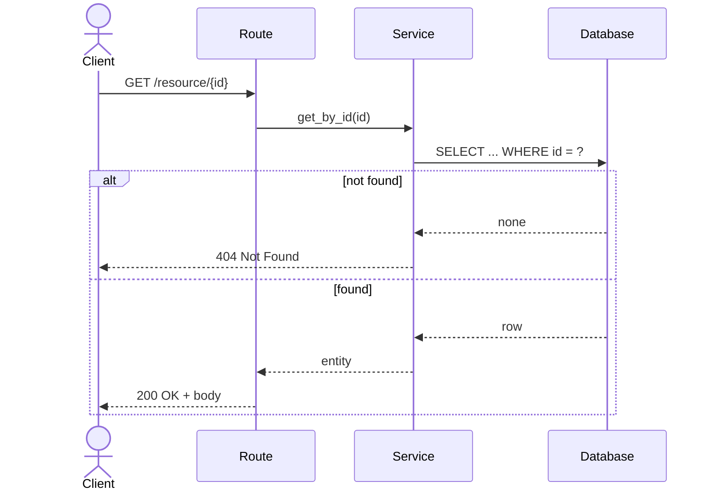

**List options:** pagination `{{?skip=&limit= | ?page=&size=}}`, filtering `{{?field=value}}`, sorting `{{?sort=-created_at}}`.

### 6.4 Update

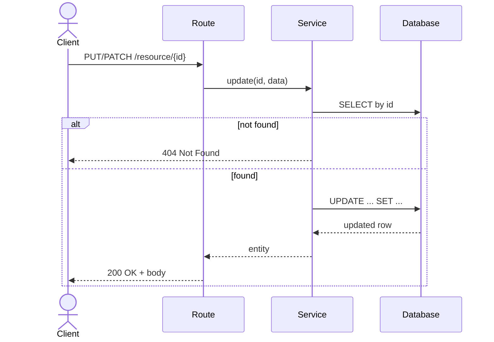

> **PUT** replaces the whole resource. **PATCH** changes only the fields sent. Write down which one this project uses.

### 6.5 Delete

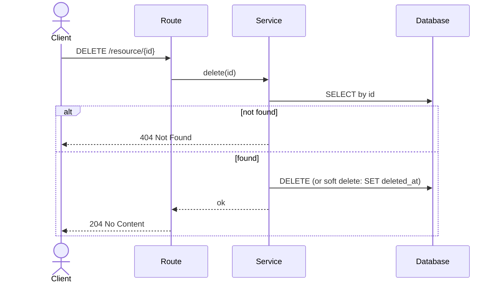

**Delete strategy:** {{Hard delete / Soft delete with `deleted_at`}}. **Cascade rules:** {{…}}

---

## 7. Function Flow

### 7.1 Application Startup

```mermaid
flowchart TD
    A[Start process] --> B[Load env / config]
    B --> C[Initialize logger]
    C --> D[Connect to database]
    D --> E[Run migrations / create tables]
    E --> F[Register middleware]
    F --> G[Register routers]
    G --> H[Start server on {{HOST}}:{{PORT}}]
```

### 7.2 Key Function Call Chain

Document the path of one core use case, e.g. "{{Place an order}}".

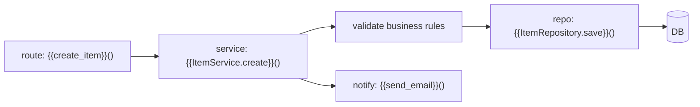

### 7.3 Function Reference

| Function | Location | Input | Output | Side effects |
|---|---|---|---|---|
| `{{func_name}}` | `{{path:line}}` | `{{params}}` | `{{return type}}` | {{DB write / external call / none}} |

### 7.4 Business Logic / State Transitions

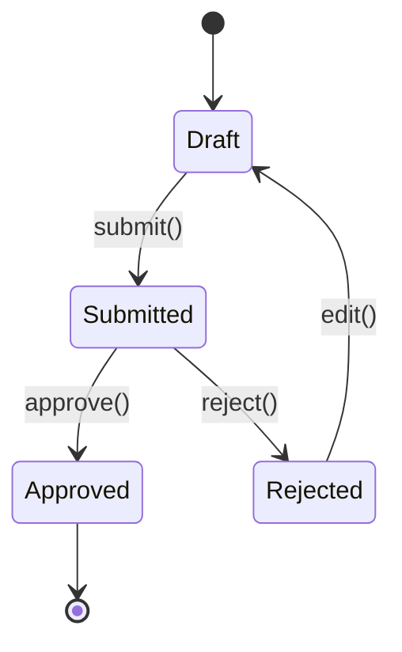

> Replace with the lifecycle of your main entity, or delete this section if nothing has states.

---

## 8. API Flow

### 8.1 Request Lifecycle

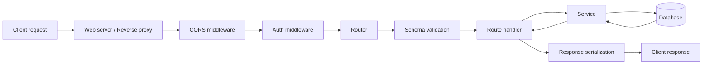

### 8.2 Base Information
- **Base URL (local):** `{{http://localhost:8000}}`
- **Base URL (prod):** `{{https://api.example.com}}`
- **API version prefix:** `{{/api/v1}}`
- **Docs:** `{{/docs}}` (Swagger), `{{/redoc}}`
- **Content type:** `application/json`

### 8.3 Endpoint Reference

| Method | Endpoint | Auth | Description | Success | Errors |
|---|---|---|---|---|---|
| `GET` | `/{{resource}}` | {{Yes/No}} | List items | 200 | 401 |
| `GET` | `/{{resource}}/{id}` | {{Yes/No}} | Get one item | 200 | 404 |
| `POST` | `/{{resource}}` | {{Yes/No}} | Create item | 201 | 400, 422 |
| `PUT` | `/{{resource}}/{id}` | {{Yes/No}} | Update item | 200 | 404, 422 |
| `DELETE` | `/{{resource}}/{id}` | {{Yes/No}} | Delete item | 204 | 404 |

### 8.4 Endpoint Detail (copy this block for each endpoint)

#### `{{METHOD}} {{/path}}`
**Description:** {{…}}

**Request**
```http
{{METHOD}} {{/path}} HTTP/1.1
Authorization: Bearer <token>
Content-Type: application/json

{
  "{{field}}": "{{value}}"
}
```

**Response `{{200}}`**
```json
{
  "id": 1,
  "{{field}}": "{{value}}"
}
```

**Errors:** `{{404}}`: {{when}} · `{{422}}`: {{when}}

**cURL**
```bash
curl -X {{METHOD}} "{{BASE_URL}}{{/path}}" \
  -H "Content-Type: application/json" \
  -d '{"{{field}}": "{{value}}"}'
```

### 8.5 Frontend ↔ Backend Interaction

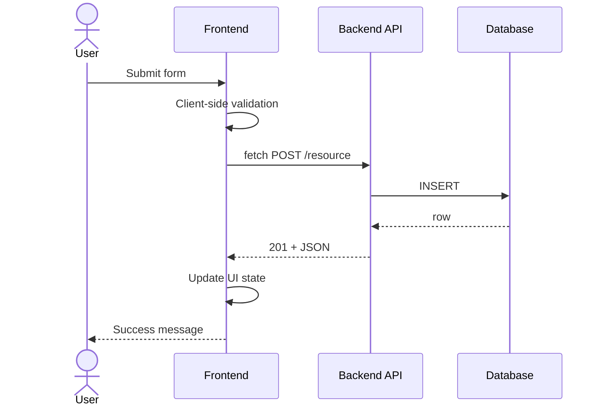

---

## 9. Authentication & Authorization

**Method:** {{JWT / Session cookie / OAuth2 / API key / None}}

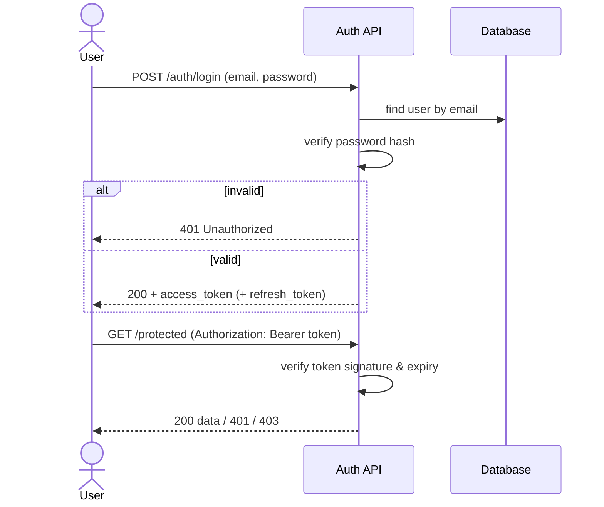

### Roles & Permissions
| Role | {{Resource}}: Create | Read | Update | Delete |
|---|---|---|---|---|
| {{Admin}} | ✅ | ✅ | ✅ | ✅ |
| {{User}} | ✅ | ✅ (own) | ✅ (own) | ❌ |
| {{Guest}} | ❌ | ✅ | ❌ | ❌ |

---

## 10. Error Handling

### 10.1 Error Response Format
```json
{
  "detail": "{{Human-readable message}}",
  "code": "{{MACHINE_READABLE_CODE}}",
  "errors": [{ "field": "{{name}}", "message": "{{…}}" }]
}
```

### 10.2 Status Codes Used
| Code | Meaning | When |
|---|---|---|
| 200 | OK | Successful read/update |
| 201 | Created | Resource created |
| 204 | No Content | Successful delete |
| 400 | Bad Request | Malformed request / business rule violated |
| 401 | Unauthorized | Missing or invalid credentials |
| 403 | Forbidden | Authenticated but not allowed |
| 404 | Not Found | Resource doesn't exist |
| 409 | Conflict | Duplicate / state conflict |
| 422 | Unprocessable Entity | Validation failed |
| 500 | Internal Server Error | Unhandled exception |

### 10.3 Error Flow

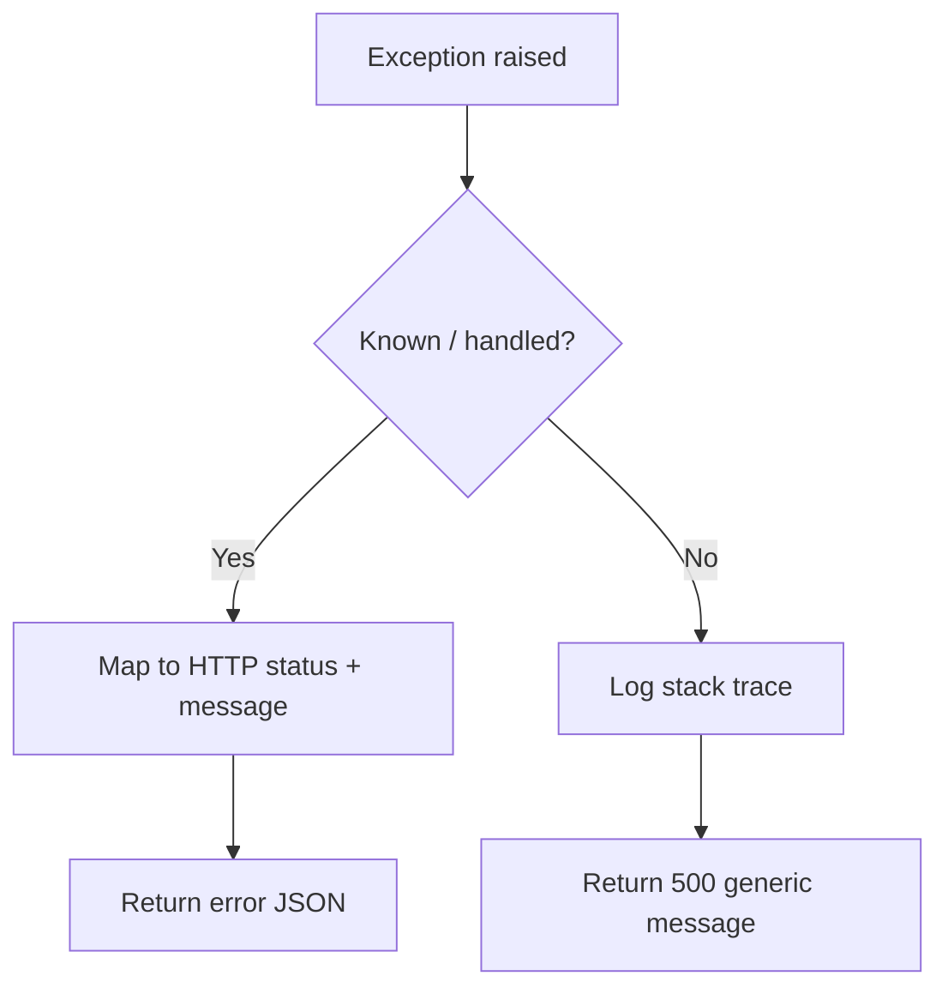

---

## 11. Testing

### 11.1 Strategy

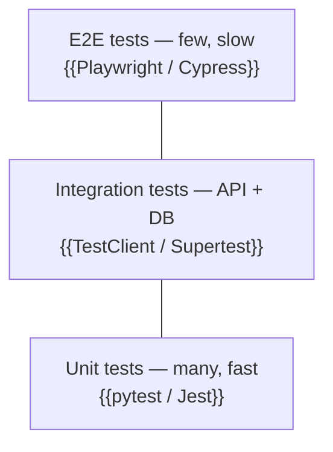

| Type | Scope | Tool | Location | Run command |
|---|---|---|---|---|
| Unit | Functions, services | {{pytest}} | `tests/unit/` | `{{pytest tests/unit}}` |
| Integration | Endpoints + test DB | {{pytest + TestClient}} | `tests/integration/` | `{{pytest tests/integration}}` |
| E2E | Full user journey | {{Playwright}} | `tests/e2e/` | `{{…}}` |
| Load | Performance | {{Locust / k6}} | `tests/load/` | `{{…}}` |

### 11.2 Test Flow

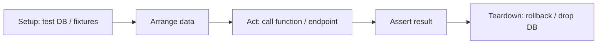

### 11.3 CRUD Test Checklist
- [ ] Create with valid data → 201
- [ ] Create with invalid/missing fields → 422
- [ ] Create duplicate unique field → 409/400
- [ ] Read existing → 200
- [ ] Read non-existent → 404
- [ ] List with pagination / filters
- [ ] Update existing → 200, fields changed
- [ ] Update non-existent → 404
- [ ] Delete existing → 204, then read → 404
- [ ] Protected routes without token → 401
- [ ] Forbidden role → 403

### 11.4 Coverage
- Target: {{80%}}
- Command: `{{pytest --cov=app --cov-report=term-missing}}`

### 11.5 Manual / API Testing
- Swagger UI: `{{/docs}}`
- Postman / Insomnia collection: `{{path or link}}`

---

## 12. Deployment

### 12.1 Environments
| Environment | URL | Branch | Database | Notes |
|---|---|---|---|---|
| Local | `{{http://localhost:8000}}` | any | {{SQLite / local PG}} | Dev |
| Staging | `{{…}}` | `{{develop}}` | {{…}} | QA |
| Production | `{{…}}` | `{{main}}` | {{…}} | Live |

### 12.2 CI/CD Pipeline

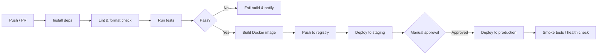

### 12.3 Deployment Architecture

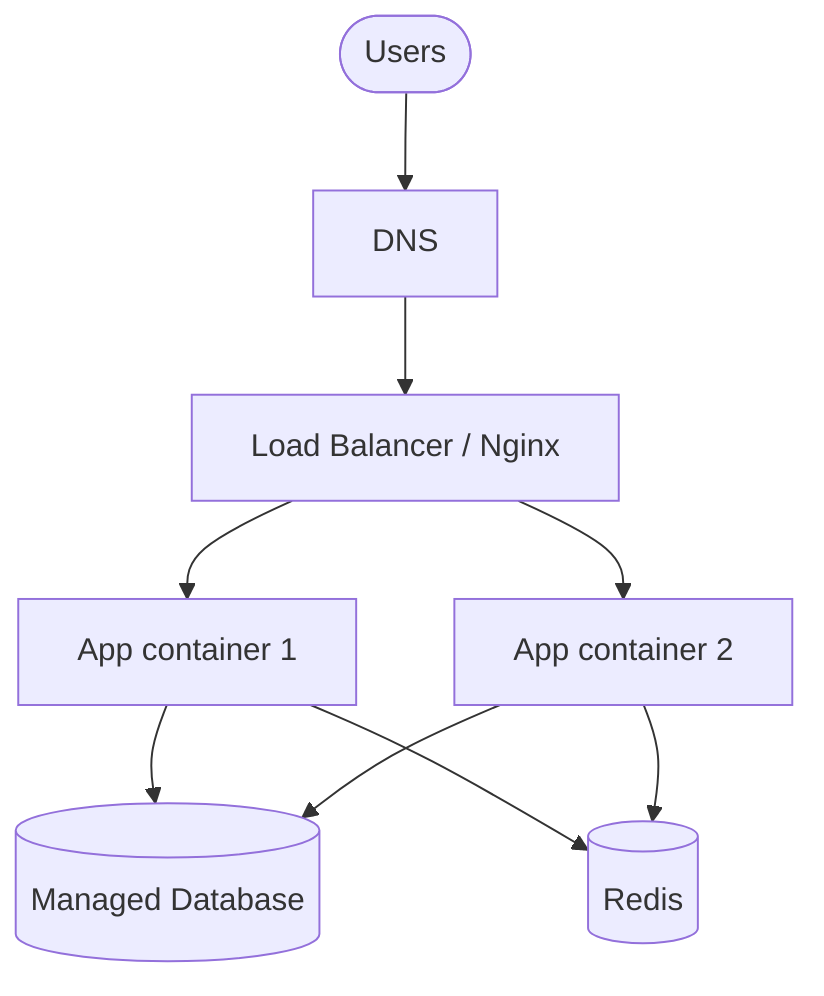

### 12.4 Run Locally
```bash
# 1. Clone
git clone {{repo-url}} && cd {{project}}

# 2. Create environment & install deps
{{python -m venv .venv && source .venv/bin/activate && pip install -r requirements.txt}}
# or: {{npm install}}

# 3. Configure env
cp .env.example .env

# 4. Run migrations
{{alembic upgrade head}}

# 5. Start
{{uvicorn main:app --reload}}
```

### 12.5 Run with Docker
```bash
docker compose up --build
```

### 12.6 Production Deploy Steps
1. {{Merge to `main`}}
2. {{CI builds and pushes image `registry/app:<sha>`}}
3. {{Run DB migrations}}
4. {{Roll out new version}}
5. {{Verify `/health` returns 200}}

### 12.7 Rollback
{{e.g. Redeploy previous image tag; run `alembic downgrade -1` if the migration is reversible.}}

---

## 13. Configuration & Environment

| Variable | Required | Default | Description |
|---|---|---|---|
| `DATABASE_URL` | ✅ | — | DB connection string |
| `SECRET_KEY` | ✅ | — | Token signing key |
| `DEBUG` | ❌ | `false` | Debug mode |
| `ALLOWED_ORIGINS` | ❌ | `*` | CORS origins |
| `{{VAR}}` | {{✅/❌}} | {{…}} | {{…}} |

> Never commit `.env`. Keep `.env.example` up to date.

---

## 14. Monitoring & Logging

- **Health check:** `GET {{/health}}` → `{"status": "ok"}`
- **Logging:** {{library}}, level `{{INFO}}`, format `{{JSON / text}}`, destination `{{stdout / file / service}}`
- **Metrics:** {{Prometheus / Datadog / none}}
- **Error tracking:** {{Sentry / none}}
- **Alerts:** {{what triggers an alert and who gets it}}

---

## 15. Glossary

| Term | Meaning |
|---|---|
| {{Term}} | {{Definition in this project's context}} |

---

## 16. Changelog

| Date | Version | Change | Author |
|---|---|---|---|
| {{YYYY-MM-DD}} | {{1.0.0}} | Initial flow document | {{Name}} |
