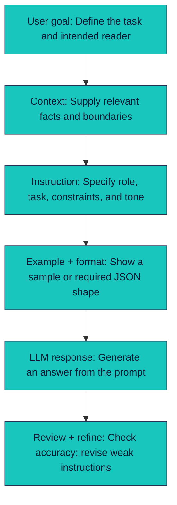
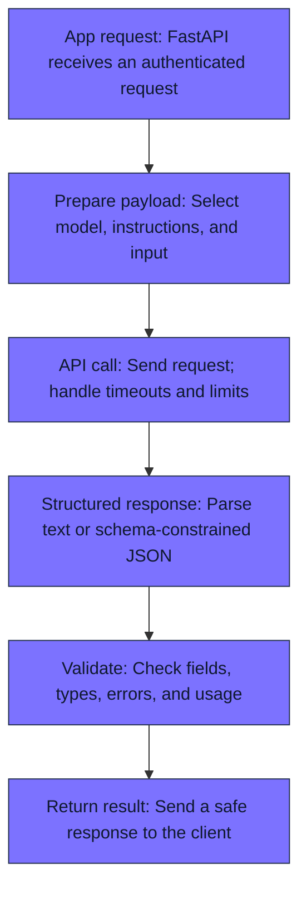
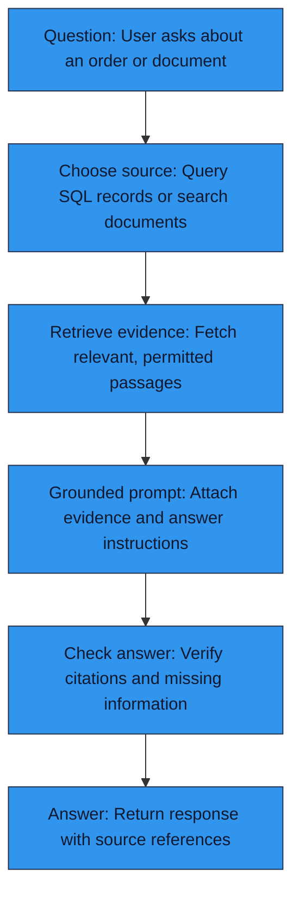
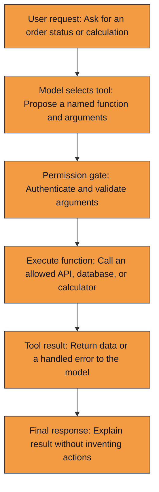
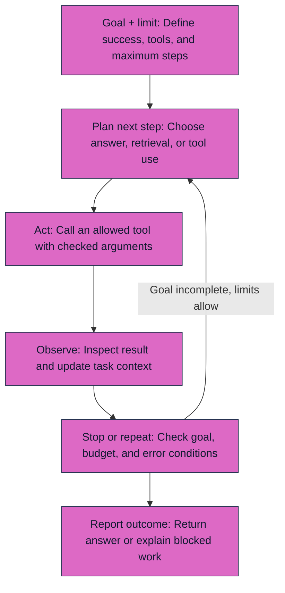
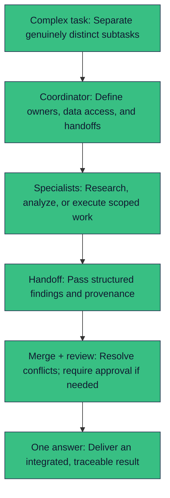
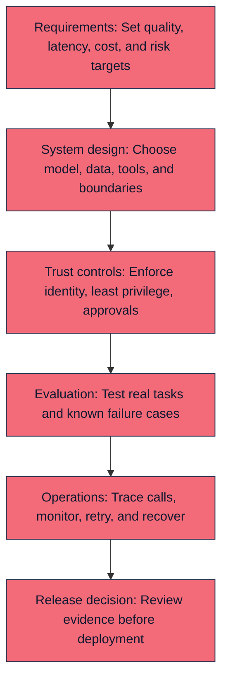
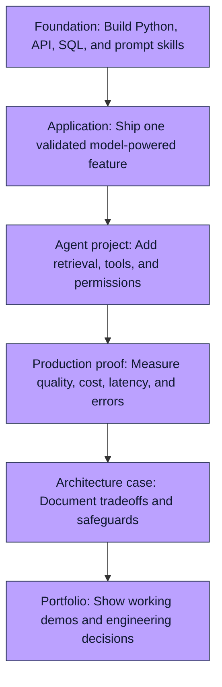

# Eight AI Agent Roadmap Flows

Each diagram has an SVG preview. To edit the flow, modify the Mermaid source below or the corresponding text.

## 01. Prompt Engineering Foundations

**Design note:** Output: a repeatable prompt and an answer checked against the goal.

## 02. Working with LLMs and APIs

**Design note:** Track latency, token usage, and cost per request.

## 03. Building AI-Powered Applications

**Design note:** RAG is useful for documents; structured SQL may be better for records.

## 04. Tool Use and Function Calling

**Design note:** The application executes tools; the model only requests them.

## 05. AI Agent Fundamentals

**Design note:** If the goal is incomplete and limits allow, repeat Plan → Act → Observe.

## 06. Multi-Agent Systems and Orchestration

**Design note:** Use multiple agents only when specialization earns its extra complexity.

## 07. AI Agent Architect Skills

**Design note:** An architect designs the whole workflow and its failure handling.

## 08. Career Path and Portfolio

**Design note:** Roles and compensation depend on market and demonstrated capability.
