# FLOW — `<PROJECT NAME>`

> **Reusable template.** Copy this file into a project as `FLOW.md` and fill it in.
> Every line in a blockquote like this one is an instruction — **delete it as you go**.
> A section that doesn't apply gets deleted too. An empty heading is worse than no heading.
>
> **What this document is for:** the *mechanics* of the system — how a request moves, where data
> lives, what calls what. It is the file a new developer reads on day one, and the file you reread
> before an interview or an incident.
> **What it is not:** setup instructions (that's `README.md`) or API reference (that's the
> generated OpenAPI/Swagger docs). Link to those instead of copying them.
>
> **Keep it under ~400 lines.** If it grows past that, the system has earned a second document.

**Status:** `draft | current | stale`  ·  **Last verified:** `YYYY-MM-DD`  ·  **Owner:** `<name/team>`

> A doc nobody dated is a doc nobody trusts. Update "last verified" whenever you reread it against
> the code — even if nothing changed.

---

## 0. How to use this file

| I want to… | Go to |
|---|---|
| Understand what this thing does | §1 Overview |
| See how the pieces fit | §2 Architecture |
| Know where data lives and how it changes | §3 Data & database flow |
| Trace one operation end to end | §4 CRUD · §6 API flow |
| Find which function calls which | §5 Function flow |
| Know what's tested and how to run it | §7 Testing |
| Ship it, or understand how it ships | §8 Deployment |
| Copy a diagram | §9 Mermaid cookbook |

---

## 1. Project overview

> Three sentences maximum before the tables. Resist the urge to write marketing copy.

**What it is.** `<One sentence: this service does X for Y.>`

**Why it exists.** `<The problem it solves. What people did before it.>`

**What it deliberately does NOT do.** `<Scope boundaries. This is the most-skipped and
most-valuable line in the document — it prevents both scope creep and "why doesn't it…" questions.>`

### Stack

| Layer | Choice | Version | Why this one |
|---|---|---|---|
| Language | `<Python>` | `<3.12>` | `<…>` |
| Framework | `<FastAPI>` | `<0.141>` | `<…>` |
| Data store | `<PostgreSQL>` | `<16>` | `<…>` |
| ORM / data access | `<SQLModel>` | `<…>` | `<…>` |
| Server / runtime | `<uvicorn>` | `<…>` | `<…>` |
| Auth | `<JWT / OAuth2 / none>` | — | `<…>` |
| Testing | `<pytest>` | `<…>` | `<…>` |
| Deploy target | `<Docker on Fly.io>` | — | `<…>` |

### Vocabulary

> Define the 3–8 domain nouns that appear in code. If two words mean the same thing, say so here
> and then pick one. Ambiguous vocabulary is the single biggest source of confusion in a codebase.

| Term | Means | In code |
|---|---|---|
| `<Order>` | `<a customer's confirmed basket>` | `models.Order` |
| `<Cart>` | `<a basket before confirmation — NOT an Order>` | `models.Cart` |

### Repository map

```
<project>/
├── main.py              # <app entry point — what it wires together>
├── models.py            # <schemas / ORM tables>
├── database.py          # <engine, session, connection lifecycle>
├── routes/              # <endpoints grouped by resource>
│   └── <resource>.py
├── services/            # <business logic, no HTTP in here>
├── tests/               # <see §7>
└── <config>             # <settings, env loading>
```

| Path | Owns | Must NOT know about |
|---|---|---|
| `routes/` | HTTP: status codes, request/response shapes | SQL, business rules |
| `services/` | business rules | HTTP, request objects |
| `models.py` | the data contract | HTTP, transport |
| `database.py` | connections and sessions | domain rules |

> That last column is the valuable one. It's how you catch a layering violation in review.

---

## 2. Architecture

### 2.1 Context — who talks to this system

> Level 1: the system as a single box, plus every external actor. If you draw only one diagram,
> draw this one.

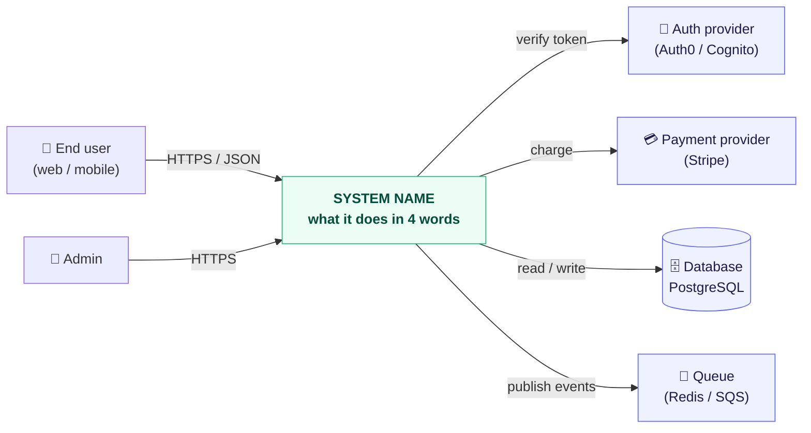

### 2.2 Containers — the deployable pieces

> Level 2: what actually runs as a separate process or service. One box per thing you could
> restart independently.

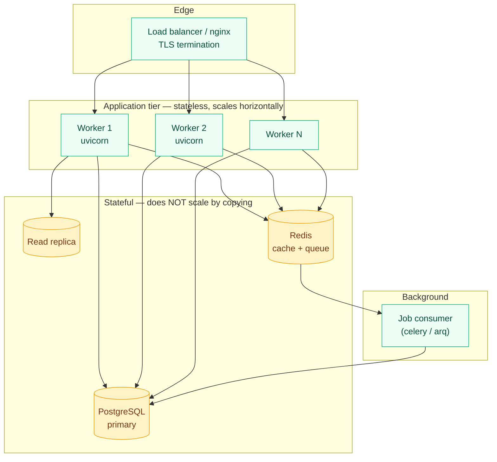

> **Mark stateless vs stateful explicitly** (colour or a legend). It answers "what can I just add
> more of?" instantly, and it's the first question asked in any scaling discussion.

### 2.3 Layers — the one-way dependency rule

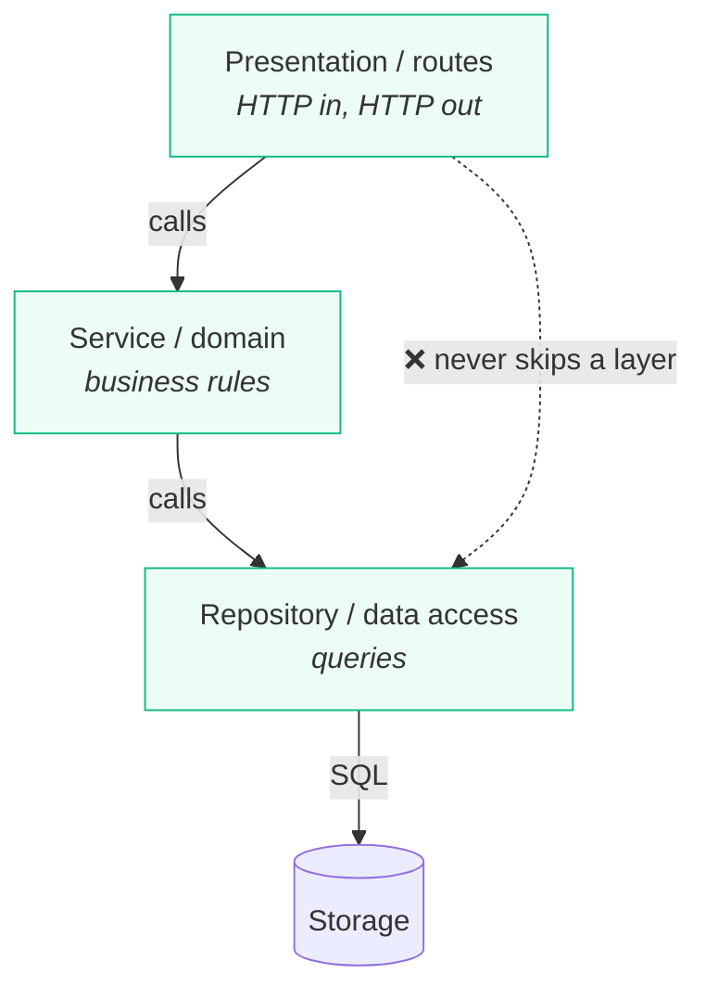

**The rule:** dependencies point **downward only**. The data layer must never import anything from
the HTTP layer — that's what makes it reusable in a CLI, a cron job, or a test.

**Where this project breaks the rule (be honest):** `<e.g. routes/ reaches into the ORM directly
for reads — acceptable for now because …>`

---

## 3. Data & database flow

### 3.1 Entity relationships

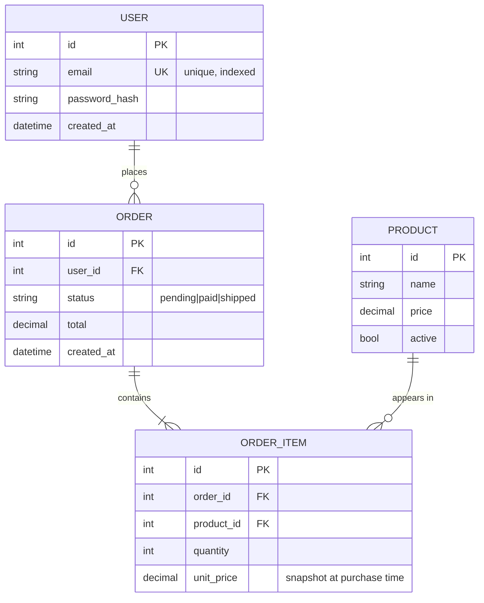

> Cardinality cheat-sheet: `||` exactly one · `o|` zero or one · `}o` zero or many ·
> `}|` one or many. Left symbol reads first: `A ||--o{ B` = "one A has zero-or-many B".

### 3.2 Table catalog

| Table | Rows (approx) | Grows with | Indexes | Notes |
|---|---:|---|---|---|
| `users` | `<10k>` | signups | `email` (unique) | |
| `orders` | `<500k>` | traffic | `user_id`, `created_at` | **hot table** |
| `order_items` | `<2M>` | orders × basket size | `order_id` | |
| `products` | `<2k>` | catalog edits | `active` | near-static → cacheable |

> The "grows with" column predicts which table hurts first. Fill it in honestly.

### 3.3 Session & transaction lifecycle

> **One session per request, never a global.** A session is a transaction; sharing one across
> concurrent requests means two requests interfering inside one transaction.

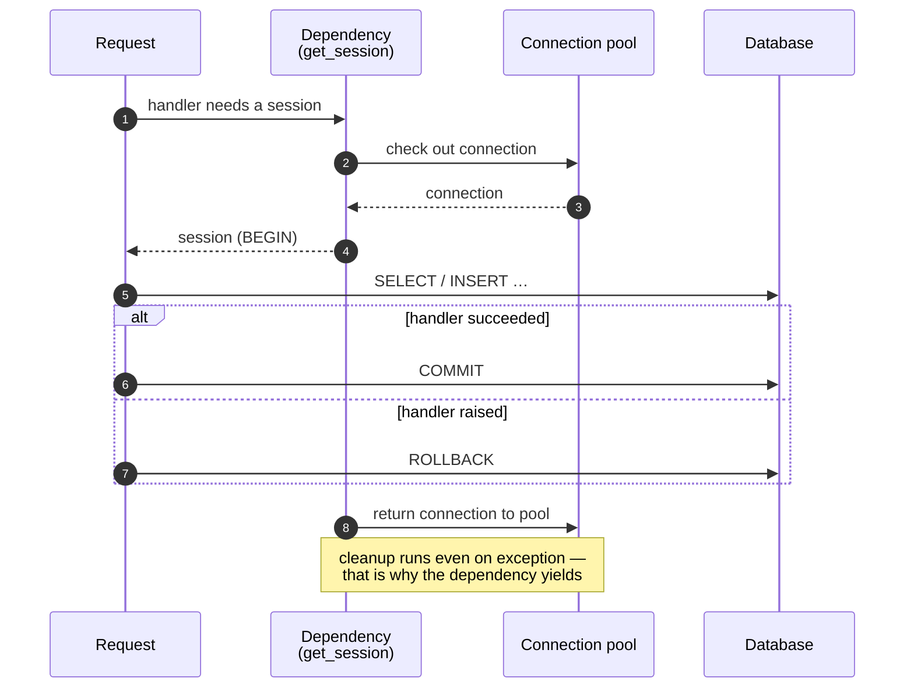

**Write path:** `add()` stages in memory → `commit()` writes and ends the transaction →
`refresh()` re-reads DB-generated values (`id`, defaults, triggers).

**Pool settings:** `<pool_size=N, max_overflow=M, timeout=Ns>` — must be ≥ worker concurrency, or
requests queue waiting for a connection.

### 3.4 Schema changes

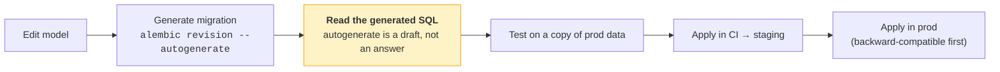

> `create_all()` creates missing tables and **never alters existing ones**. It is fine for a demo
> and wrong for anything with real data. Adopt migrations before the first production write.
>
> **Expand/contract for zero-downtime:** add the nullable column → deploy code that writes both →
> backfill → deploy code that reads new → drop old. Never rename in one step.

---

## 4. CRUD operations

### 4.1 Operation matrix

> One row per entity × operation. This single table answers most "how do I…?" questions.

| Entity | Op | Method & path | Auth | Request | Success | Errors | Side effects |
|---|---|---|---|---|---|---|---|
| Order | Create | `POST /orders` | user | `OrderCreate` | `201` + `OrderRead` | `422`, `401` | charges card, emits `order.created` |
| Order | Read one | `GET /orders/{id}` | owner | — | `200` | `404`, `403` | — |
| Order | Read many | `GET /orders` | user | query params | `200` (paginated) | `422` | — |
| Order | Update | `PATCH /orders/{id}` | owner | `OrderUpdate` | `200` | `404`, `409` | — |
| Order | Replace | `PUT /orders/{id}` | admin | `OrderReplace` | `200` | `404` | — |
| Order | Delete | `DELETE /orders/{id}` | admin | — | `204` | `404` | soft delete |

### 4.2 PUT vs PATCH in this project

| | PUT | PATCH |
|---|---|---|
| Means | replace the whole resource | merge these fields |
| Omitted field | reset to default / cleared | **left unchanged** |
| Model | all fields required | all fields optional |
| Implementation | — | `model_dump(exclude_unset=True)` |
| Idempotent | yes | usually, not guaranteed |

> `exclude_unset=True` is what distinguishes "field absent" from "field explicitly set to null".
> Without it, PATCH silently overwrites every unmentioned column with `None`.

### 4.3 Create — the full path

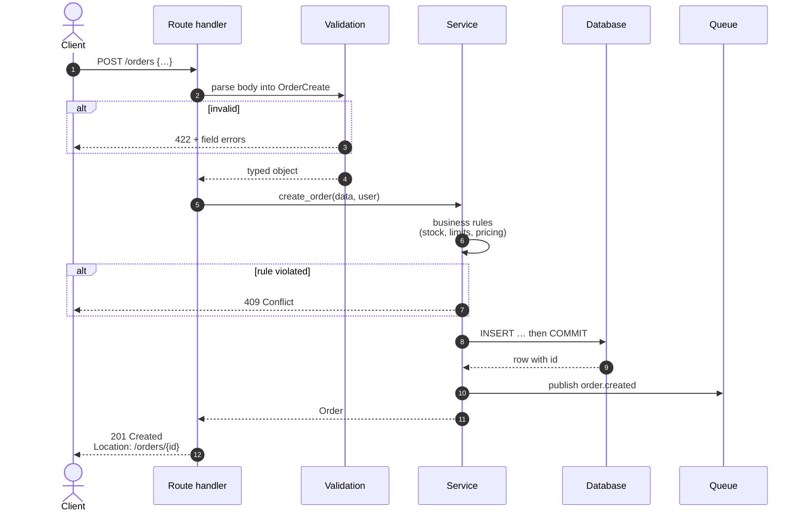

### 4.4 Entity lifecycle

> Any entity with a `status` column deserves a state diagram. It documents which transitions are
> legal — and therefore which ones the code must reject.

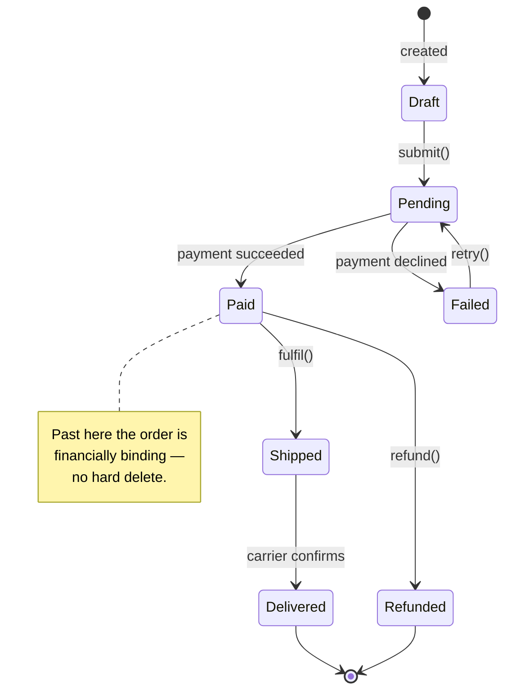

**Illegal transitions** (must raise, with the status code): `<Draft → Shipped → 409>` …

---

## 5. Function flow

### 5.1 Module dependencies

> If this graph has a cycle, you have a circular import waiting to happen.

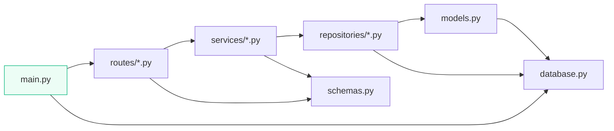

### 5.2 Call graph — `<name the most important operation>`

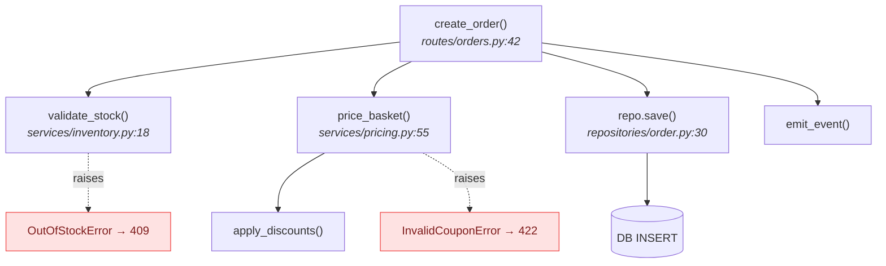

> Cite `file.py:line` in node labels. It turns the diagram into a navigation tool.

### 5.3 Key functions

| Function | File | Does | Raises | Notes |
|---|---|---|---|---|
| `create_order()` | `routes/orders.py:42` | orchestrates creation | `409`, `422` | transaction boundary |
| `price_basket()` | `services/pricing.py:55` | totals + discounts | `InvalidCouponError` | **pure — easy to test** |

### 5.4 Sync vs async

| Path | `def` or `async def` | Why |
|---|---|---|
| `<GET /orders>` | `async def` | async DB driver, awaits I/O |
| `<report generation>` | `def` | blocking library → threadpool |

> **The rule:** `async def` only when something is genuinely awaitable. A blocking call inside
> `async def` stalls *every* concurrent request; the same call in a plain `def` is offloaded to a
> threadpool and harms only itself. CPU-heavy work belongs in neither — send it to a worker.

---

## 6. API flow

### 6.1 Request lifecycle

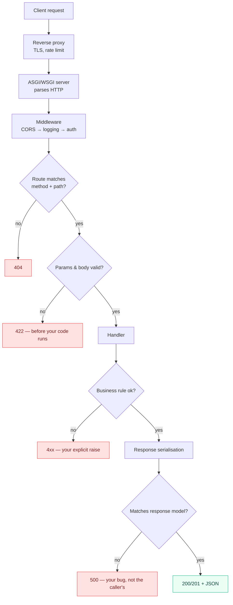

> **The framing worth memorising:** `422` is raised **before** your handler, `4xx` **inside** it,
> `500` **after** it. Inbound and outbound validation are the same machinery pointed opposite ways.

### 6.2 Endpoint catalog

| Method | Path | Auth | Purpose | Success | Errors |
|---|---|---|---|---|---|
| `GET` | `/health` | none | liveness | `200` | — |
| `GET` | `/orders` | user | list, paginated | `200` | `401` |
| `POST` | `/orders` | user | create | `201` | `401`, `422`, `409` |

### 6.3 Status code contract

| Code | Used when | Body |
|---|---|---|
| `200` | read / update succeeded | resource |
| `201` | created | resource + `Location` header |
| `204` | deleted | **empty** |
| `400` | malformed request | error envelope |
| `401` | missing/invalid credentials | error envelope |
| `403` | authenticated but not allowed | error envelope |
| `404` | resource does not exist | error envelope |
| `409` | conflicts with current state | error envelope |
| `422` | well-formed but semantically invalid | field-level errors |
| `429` | rate limited | + `Retry-After` |
| `500` | our bug | opaque — **never leak internals** |

> **404 vs empty list:** 404 for a *missing single resource*; `200` with `[]` for a *filter that
> matched nothing*. A filter finding zero rows is a successful query.

### 6.4 Error envelope

```json
{
  "error": "out_of_stock",
  "message": "Product 42 has 0 units remaining",
  "details": { "product_id": 42 },
  "request_id": "01HQ…"
}
```

> One shape for every error, defined in one place. `request_id` is what turns a user's screenshot
> into a log query — include it even if nothing else.

### 6.5 Authentication flow

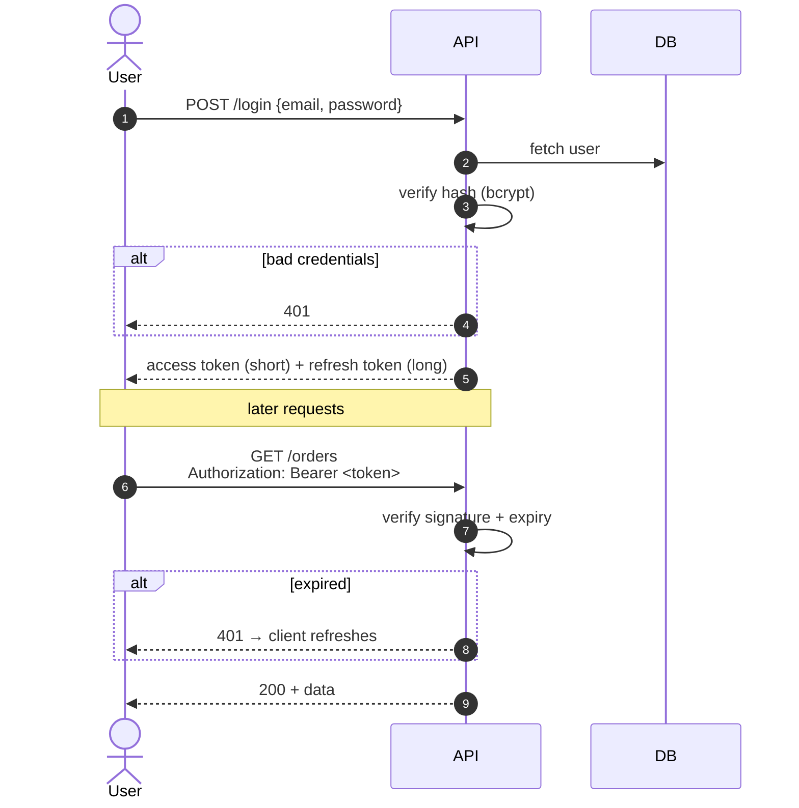

**Authentication** = who you are. **Authorization** = what you may do. Separate concerns, often
separate dependencies.

### 6.6 Cross-cutting

| Concern | Decision |
|---|---|
| Pagination | `<limit/offset — needs a stable ORDER BY, or rows repeat across pages>` |
| Versioning | `<URL /v1/ · header · none>` |
| CORS | `<allowed origins — enforced by the browser, not a server-side security control>` |
| Rate limits | `<N/min per key, counter in Redis>` |
| Idempotency | `<Idempotency-Key header on POST; stored N hours>` |

---

## 7. Testing

### 7.1 What's tested where

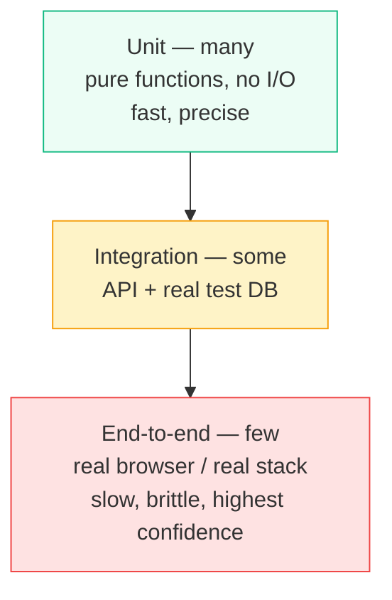

| Layer | Location | Count | Runtime | Covers |
|---|---|---:|---|---|
| Unit | `tests/unit/` | `<120>` | `<2s>` | pricing, validators |
| Integration | `tests/integration/` | `<40>` | `<30s>` | endpoints + DB |
| E2E | `tests/e2e/` | `<5>` | `<3m>` | checkout happy path |

### 7.2 Running them

```bash
<pytest>                                  # everything
<pytest tests/unit -q>                    # fast loop
<pytest --cov=app --cov-report=term-missing>
<pytest -k "order and not slow">
```

### 7.3 Fixtures and doubles

| Fixture | Scope | Provides |
|---|---|---|
| `client` | function | in-process API client, no network |
| `db_session` | function | transaction rolled back after each test |
| `auth_headers` | function | valid token |

> **Test DB strategy:** `<each test in a transaction that's rolled back>` — fast and isolated.
> **Don't mock what you own.** Mock the payment provider; use a real test database.
> A suite that passes while the app is broken is worse than no suite.

### 7.4 What is NOT tested

> Name the gaps. An honest gap list is the most useful part of this section.

- `<the retry path in the queue consumer>`
- `<migrations are never run against production-shaped data>`

---

## 8. Deployment

### 8.1 Environments

| Env | URL | Data | Deploys from | Who can |
|---|---|---|---|---|
| local | `localhost:8000` | fixtures | working tree | anyone |
| staging | `<…>` | anonymised copy | `main` | CI |
| production | `<…>` | real | tagged release | CI + approval |

### 8.2 Pipeline

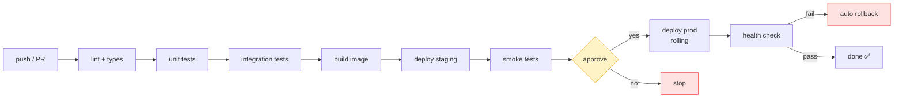

### 8.3 Runtime configuration

| Setting | Env var | Local | Prod | Secret |
|---|---|---|---|---|
| Database URL | `DATABASE_URL` | local pg | managed | ✅ |
| Log level | `LOG_LEVEL` | `DEBUG` | `INFO` | ❌ |
| Allowed origins | `CORS_ORIGINS` | `*` | explicit list | ❌ |
| Workers | `WEB_CONCURRENCY` | 1 | `<N>` | ❌ |

> **Config comes from the environment, never from code.** Secrets never enter the repo, the image,
> or a log line. The same artefact must run in every environment — only the env differs.

### 8.4 Production checklist

- [ ] Dev-only reloader off; `<N>` workers behind a reverse proxy
- [ ] Dependency versions pinned / lockfile committed
- [ ] Migrations run as a separate step *before* the new code serves traffic
- [ ] Health endpoint wired to the load balancer
- [ ] Structured logs with a request id
- [ ] Metrics + alerts on error rate and p99 latency
- [ ] Interactive API docs deliberately public or disabled
- [ ] Backups verified by an actual restore
- [ ] Rollback tested, not assumed

### 8.5 Rollback

**Code:** `<redeploy previous tag — one command, state it here>`
**Database:** `<expand/contract means the old code still works against the new schema; a migration
that drops a column is a one-way door — list those separately>`

**One-way doors in this system:** `<destructive migrations, external charges, sent emails>`

### 8.6 Observability

| Signal | Where | Alert when |
|---|---|---|
| Logs | `<…>` | — |
| Metrics | `<…>` | `5xx > 1%` for 5 min |
| Traces | `<…>` | — |
| Uptime | `<…>` | health check fails twice |

**First three things to check during an incident:** `<1. … 2. … 3. …>`

---

## 9. Mermaid cookbook

> Copy-paste starting points. All of these render on GitHub, GitLab, Obsidian, and VS Code with the
> Markdown Preview Mermaid extension. Fenced as ` ```mermaid `.

<details>
<summary><b>Flowchart</b> — architecture, decisions, pipelines</summary>

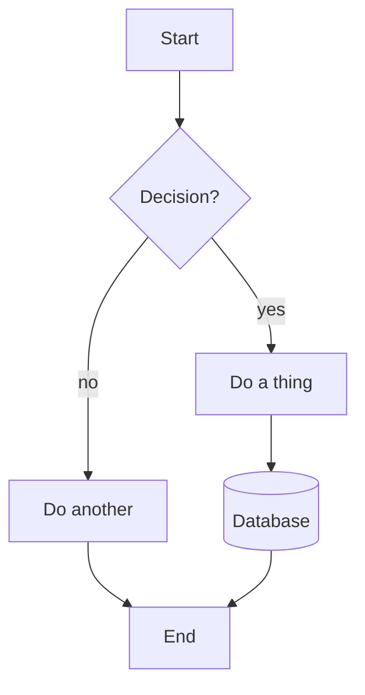

Directions: `TD` top-down · `LR` left-right · `BT` · `RL`.
Shapes: `["rect"]` · `("round")` · `{"diamond"}` · `[("database")]` · `(("circle"))` ·
`[/"parallelogram"/]`.
Arrows: `-->` solid · `-.->` dotted · `==>` thick · `-->|label|`.
</details>

<details>
<summary><b>Sequence diagram</b> — request flows, protocols, handshakes</summary>

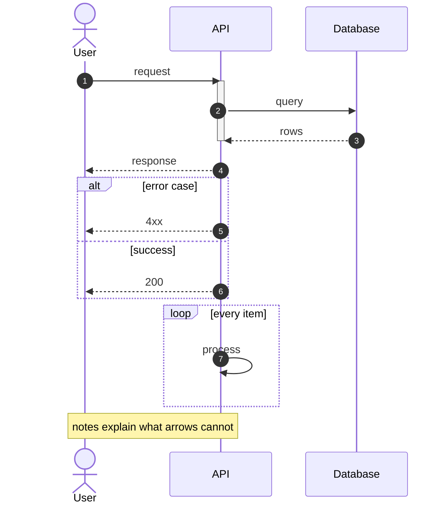

`->>` solid arrow · `-->>` dashed (reply) · `-x` lost message.
</details>

<details>
<summary><b>ER diagram</b> — data models</summary>

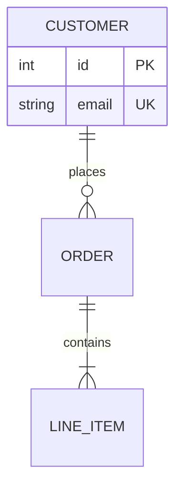

`||` one · `o|` zero-or-one · `}o` zero-or-many · `}|` one-or-many.
Keys: `PK` · `FK` · `UK`.
</details>

<details>
<summary><b>State diagram</b> — entity lifecycles, status columns</summary>

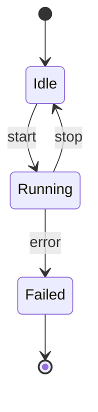
</details>

<details>
<summary><b>Class diagram</b> — domain models, inheritance</summary>

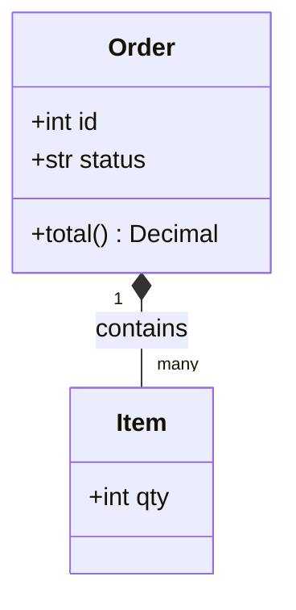

`<|--` inheritance · `*--` composition · `o--` aggregation · `-->` association.
</details>

<details>
<summary><b>Gantt</b> — roadmaps</summary>

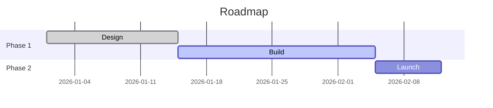
</details>

<details>
<summary><b>Pie</b> — simple proportions</summary>

```mermaid
pie showData
    title Requests by endpoint
    "GET /orders" : 55
    "POST /orders" : 30
    "other" : 15
```
</details>

<details>
<summary><b>Git graph</b> — branching strategy</summary>

```mermaid
gitGraph
    commit
    branch feature
    checkout feature
    commit
    checkout main
    merge feature
    commit
```
</details>

### Gotchas that cost the most time

| Problem | Fix |
|---|---|
| Label contains `(`, `:`, `,`, `-` and breaks | wrap in double quotes: `A["text (v2)"]` |
| Need a line break in a node | `<br/>` inside a quoted label |
| Arrow label with spaces | `A -->|"two words"| B` |
| A node id collides with a keyword (`end`, `graph`, `class`) | rename it, or capitalise |
| `;` inside a sequence-diagram message kills the parse | it's a statement separator — write `then`, or use `,` |
| Diagram silently doesn't render | check the fence says exactly `mermaid`, lowercase |
| Emoji breaks layout | keep them out of node **ids**; labels are fine |
| Comment | a line starting with `%%` |

**Preview locally:** VS Code → *Markdown Preview Mermaid Support*, or paste into
<https://mermaid.live>.

---

## 10. Appendix

### 10.1 Decisions

> One line each: what was decided, when, and the alternative rejected. Link to a full ADR if one
> exists. This is the section your future self will thank you for.

| Date | Decision | Instead of | Because |
|---|---|---|---|
| `<YYYY-MM-DD>` | `<chose X>` | `<Y>` | `<reason>` |

### 10.2 Known issues

| Issue | Impact | Workaround | Tracked |
|---|---|---|---|
| `<…>` | `<…>` | `<…>` | `<#123>` |

### 10.3 If asked "what would you improve?"

> Knowing your own system's weak points reads better than claiming it has none. Keep 5–8 ready.

1. `<…>`
2. `<…>`

### 10.4 Related documents

| Document | Covers |
|---|---|
| `README.md` | install and run |
| `/docs` (generated) | endpoint reference |
| `CONTRIBUTING.md` | workflow and conventions |

---

> **Maintenance:** reread this against the code whenever an endpoint, a table, or a deployment step
> changes — and update the "Last verified" date at the top. A confidently wrong diagram does more
> damage than a missing one.
