# Agentic AI: The Complete Agent Flow (Explained Simply)

> **Goal of this note:** Understand every step of an AI agent, from the user's prompt to evaluation and improvement, using **3 everyday examples**, the **frameworks/tools** used at each step, and **flow, system design and UML diagrams**.

> **Diagrams:** All diagrams use **Mermaid**. They render in GitHub, Obsidian, and VS Code (install the *"Markdown Preview Mermaid Support"* extension, then open the preview with `Ctrl+Shift+V`).

---

## 0. One-Line Idea

> **Chatbot = LLM answers.  Agent = LLM thinks, fetches context, uses tools, checks its own work, and learns.**

```
AGENT = LLM (brain) + Context (RAG + Memory) + Tools/MCP (hands) + Loop (plan → act → check → replan) + Memory update + Evaluation
```

A normal chatbot is like a **person who only talks**.
An agent is like an **employee**: it reads company documents (RAG), remembers you (memory), uses software (tools), checks its work (reflection), reports back (final response + audit), and gets better over time (feedback + evaluation).

---

## 1. The Full Agent Flow (Big Picture)

| # | Step | Simple meaning | Human analogy |
|---|------|----------------|---------------|
| 1 | **User Prompt** | The request | Customer asks a question at the help desk |
| 2 | **LLM (Brain)** | Understands intent, reasons, decides | The employee's brain |
| 3 | **Context Gathering** | Collect the info needed before acting | Employee checks files, notes, systems |
| 3a | ↳ **RAG** | Search company documents | Opens the HR policy binder |
| 3b | ↳ **Memory Retrieval** | Recall past chats / user preferences | "Oh, this is Rakesh, he asked last week too" |
| 3c | ↳ **Tools / MCP discovery** | See which tools are available | Checks which software they have access to |
| 4 | **Planning** | Break the task into steps | Makes a to-do list |
| 5 | **Tool Selection** | Choose the right tool + arguments | Picks the right software |
| 6 | **Action Execution** | Actually call the tool / API | Clicks "Submit" |
| 7 | **Result Verification / Reflection** | Check if the result is correct | Double-checks the output |
| 8 | **Plan Revision (Replan)** | Fix the plan if something failed | "That didn't work, let me try another way" |
| 9 | **Task Completion** | Decide the goal is achieved | Ticks off the to-do list |
| 10 | **Final Response / Audit** | Reply to user + log everything | Replies to the customer + writes in the register |
| 11 | **Memory Update** | Save useful facts for next time | Notes "customer prefers email" |
| 12 | **Feedback** | User rates the answer | Customer fills a feedback form |
| 13 | **Evaluation / Monitoring / Improvement** | Measure quality, watch production, improve | Manager reviews performance, gives training |

### 1.1 Flow Diagram (Flowchart)

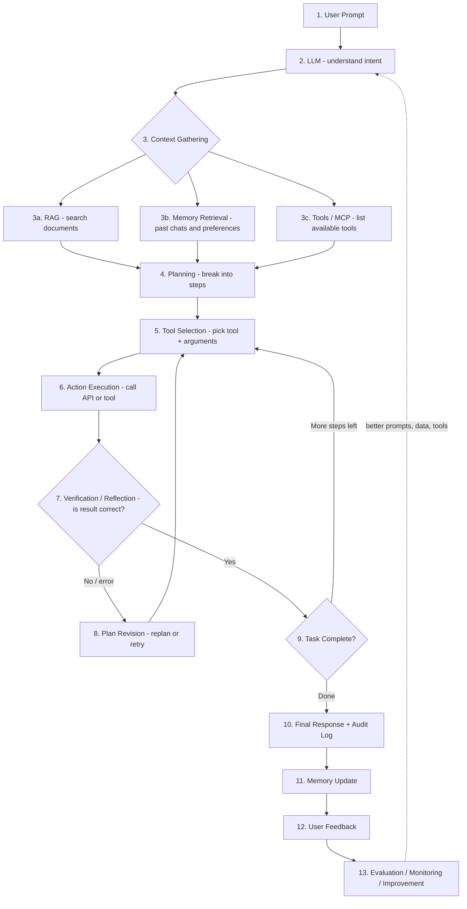

### 1.2 Simple ASCII Version (for quick revision)

```
User Prompt
    │
    ▼
  LLM ──► Context Gathering ──► [ RAG | Memory | Tools/MCP ]
    │
    ▼
 Planning ──► Tool Selection ──► Action Execution
    ▲                                   │
    │                                   ▼
 Plan Revision ◄── NO ── Verification / Reflection
                                        │ YES
                                        ▼
                                 Task Completion
                                        │
                                        ▼
                          Final Response + Audit Log
                                        │
                                        ▼
                    Memory Update ──► Feedback ──► Evaluation / Monitoring ──► Improve
```

---

## 2. The 3 Real-Life Examples Used Throughout

| # | Example | User prompt | Why it needs an agent |
|---|---------|-------------|-----------------------|
| **E1** | 🏢 **HR Leave Policy Assistant** | *"How many casual leaves do I have left? Apply 2 days leave next Monday–Tuesday."* | Needs **RAG** (leave policy), **tool** (HR system balance), **action** (apply leave) |
| **E2** | 📦 **E-commerce Delivery Address Change** | *"Change the delivery address of my order 4521 to 12 MG Road, Bengaluru 560001."* | Needs **memory** (who the user is), **tools** (order API, address validator), **verification** (is order already shipped?) |
| **E3** | 🔎 **Company Lookup for Sales (Company Name → Address → CRM)** | *"Find the registered address and website of 'TechNova Pvt Ltd' and add it as a lead in our CRM."* | Needs **web search tool**, **reflection** (is it the right company?), **action** (create CRM lead) |

### 2.1 Each Example Through ALL 13 Steps

Every example uses **every** concept, not just LLM, RAG and tools. Read each column top to bottom to see one full agent run.

| # | Step | 🏢 E1 Leave Policy | 📦 E2 Address Change | 🔎 E3 Company Lookup |
|---|------|--------------------|----------------------|----------------------|
| 1 | **User Prompt** | "How many CL left? Apply 2 days next Mon–Tue." | "Change address of order 4521 to 12 MG Road, 560001." | "Find TechNova Pvt Ltd's address and website, add to CRM." |
| 2 | **LLM** | Finds 2 intents: *check balance* + *apply leave*; dates = 16–17 Nov | Intent *update_address*; entities: order 4521, new address | Intents *research company* + *create lead*; entity "TechNova Pvt Ltd" |
| 3a | **RAG** | Leave policy: "12 CL/year, max 3 days in a row, apply 1 day before" | Shipping FAQ: "Address can change only before shipping" | Sales playbook: "Lead needs name, address, website, industry" |
| 3b | **Memory Retrieval** | Emp ID EMP102, manager Priya | Customer C77, saved addresses, owns order 4521 | "No past research on TechNova" |
| 3c | **Tools / MCP** | HR MCP: `get_leave_balance`, `get_holidays`, `apply_leave` | Order MCP: `get_order`, `update_order_address`, `create_redirect_request`; Maps: `validate_address` | `crm_search`, `web_search`, `fetch_webpage`, `crm_create_lead` |
| 4 | **Planning** | ① check balance ② check holidays ③ check rules ④ apply ⑤ confirm | ① get order status ② validate address ③ update ④ confirm | ① CRM duplicate check ② web search ③ verify company ④ create lead |
| 5 | **Tool Selection** | `get_leave_balance(EMP102)`, then `get_holidays(2026)` | `get_order(4521)` first, **not** `update` directly | `crm_search("TechNova")`, then `web_search(...)` |
| 6 | **Action Execution** | Balance = 5 CL; 16–17 Nov are working days; `apply_leave(...)` → ticket LV-889 | `get_order` → status **shipped**; `validate_address` → valid | CRM: not found; web: **2 companies** (Bengaluru and Pune) |
| 7 | **Verification / Reflection** | ✅ 2 ≤ 3-day limit, 5 ≥ 2 balance, not a holiday | ❌ "Order already shipped, so the policy blocks a direct update" | ❌ "Two matches: which TechNova is the right one?" |
| 8 | **Plan Revision** | Not needed. *(If only 1 CL left → replan: 1 CL + 1 EL, or ask user)* | New plan: `create_redirect_request` with courier instead | New plan: check company registry for "Pvt Ltd" → Bengaluru, 560025, technova.in |
| 9 | **Task Completion** | Leave applied, LV-889 pending approval → stop | Redirect request R-12 created → stop | Verified, then `crm_create_lead` → L-120 → stop |
| 10 | **Final Response / Audit** | "2 days CL applied (LV-889), 3 CL left. Source: Policy §4.2." Audit logs all 3 tool calls | "Order already shipped; redirect R-12 raised." Audit logs the blocked update + redirect | "Address + website + lead L-120, sources: website, registry." Audit logs searches + sources |
| 11 | **Memory Update** | Save "EMP102 leave LV-889, 16–17 Nov" | Save new address as preferred (with consent) | Save "TechNova = lead L-120, verified 2026-11-11" |
| 12 | **Feedback** | 👍 from user; manager approves leave (good signal) | 👎 "Wrong flat number" (address parsing issue) | Sales rep edits the address in CRM (implicit: agent was wrong) |
| 13 | **Evaluation / Monitoring / Improvement** | Eval: faithfulness to policy, success rate. Monitor HR API errors. Improve: add holiday test cases | Eval: tool-order accuracy (`get` before `update`). Monitor 👎 rate. Improve: better address parser + test case | Eval: address accuracy vs registry. Monitor search cost. Improve: always check registry first; add to golden set |

> 🔑 **Notice:** E1 is the "happy path" (no replan). E2 shows **verification blocking a wrong action** and the agent **replanning**. E3 shows **reflection catching ambiguity** before writing bad data into the CRM. Together they cover every step.

---

## 3. Every Term Explained (with the 3 Examples + Tools)

### Step 1: User Prompt

**What:** The natural-language request from the user. A **system prompt** (hidden instructions) is added by the developer: role, rules, tone, allowed tools.

| | E1 Leave | E2 Address | E3 Company |
|---|---|---|---|
| User prompt | "How many CL left? Apply 2 days." | "Change address of order 4521." | "Find TechNova's address, add to CRM." |
| System prompt | "You are an HR assistant. Follow company policy only." | "You are a support agent. Never change shipped orders." | "You are a sales research assistant. Verify sources." |

**Tools:** Prompt templates in **LangChain `ChatPromptTemplate`**, **LlamaIndex PromptTemplate**, **Jinja2**, prompt management in **LangSmith Hub / Langfuse Prompts / PromptLayer**.

---

### Step 2: LLM (The Brain)

**What:** The Large Language Model that **understands intent**, **reasons**, and **decides what to do next**. It does not "know" your company data; that comes from context.

- **E1:** Detects 2 intents: *query balance* + *apply leave*.
- **E2:** Detects intent *update_address*, entities: `order_id=4521`, `new_address=...`.
- **E3:** Detects intent *company_research* + *create_lead*, entity `company_name="TechNova Pvt Ltd"`.

**Tools / Models:**
- Closed: **OpenAI GPT-4o / GPT-4.1**, **Anthropic Claude (Opus/Sonnet/Haiku)**, **Google Gemini**
- Open source: **Llama 3**, **Mistral**, **Qwen** (run locally with **Ollama**, **vLLM**, **Hugging Face TGI**)
- Access: **OpenAI SDK**, **Anthropic SDK**, **LiteLLM** (one API for all models), **Azure OpenAI**, **AWS Bedrock**

> 💡 **Interview tip:** Use a **big model for planning** and a **small/cheap model for simple steps** (routing, classification) to save cost.

---

### Step 3: Context Gathering

**What:** Before acting, the agent collects everything it needs. LLM + context = good decisions. Three sources:

#### 3a. RAG (Retrieval-Augmented Generation)

**What:** Search your own documents and give the relevant chunks to the LLM, so it answers from **facts, not guesses**.

**How it works:**
```
Documents → Chunk → Embed (vectors) → Store in Vector DB
Query → Embed → Similarity Search → Top-k chunks → (Rerank) → Put into prompt → LLM answers
```

- **E1 (main use):** Searches `Leave_Policy_2026.pdf` → finds *"Employees get 12 casual leaves/year. CL cannot exceed 3 consecutive days. Apply 1 day in advance."*
- **E2:** Searches `Shipping_FAQ` → *"Address can be changed only before the order is shipped."*
- **E3:** Searches internal `Sales_Playbook` → *"Lead must have company name, address, website, industry."*

**Tools:**
- Frameworks: **LangChain**, **LlamaIndex**, **Haystack**
- Embeddings: **OpenAI text-embedding-3**, **Sentence-Transformers (BGE, MiniLM)**, **Cohere Embed**
- Vector DBs: **FAISS**, **Chroma**, **Pinecone**, **Qdrant**, **Weaviate**, **Milvus**, **pgvector** (Postgres), **Elasticsearch/OpenSearch** (hybrid search)
- Rerankers: **Cohere Rerank**, **bge-reranker**, cross-encoders

#### 3b. Memory Retrieval

**What:** Recall things about the **user or past conversations**.

| Type | Meaning | Example |
|------|---------|---------|
| **Short-term memory** | Current conversation (chat history) | "next Monday" → the agent remembers you said "2 days" earlier in the chat |
| **Long-term memory** | Saved across sessions | "Rakesh is in Bengaluru office, manager = Priya" |
| **Episodic memory** | Past events/tasks | "Last time address change failed because order was shipped" |
| **Semantic memory** | Facts/knowledge | "Company TechNova is already in CRM as a lead" |
| **Procedural memory** | How to do tasks | Saved steps / instructions that worked |

- **E1:** Recalls employee ID `EMP102`, manager `Priya`, previously applied leaves.
- **E2:** Recalls customer ID, saved addresses, past orders.
- **E3:** Recalls *"Already searched TechNova last month, lead id L-77"* → avoids duplicates.

**Tools:** **LangGraph checkpointer + Store**, **LangChain memory (ConversationBufferMemory, SummaryMemory)**, **Mem0**, **Zep**, **Letta (MemGPT)**, **Redis**, **PostgreSQL**, vector DB for semantic memory.

#### 3c. Tools / MCP (Model Context Protocol)

**What:**
- A **tool** is a function the agent can call (API, DB query, search, email, calculator). It has a **name, description, and input schema** (JSON schema) so the LLM knows when and how to use it.
- **MCP (Model Context Protocol)** is an open standard (by Anthropic) for plugging tools and data into any AI app, like a **USB-C port for AI**. You build an **MCP server** once (for example, "HR system MCP server") and any MCP client (Claude Desktop, Claude Code, Cursor, LangGraph, OpenAI Agents SDK) can use it.

| Example | Tools available |
|---------|-----------------|
| E1 | `get_leave_balance(emp_id)`, `apply_leave(emp_id, from, to, type)`, `get_holidays(year)` |
| E2 | `get_order(order_id)`, `validate_address(address)`, `update_order_address(order_id, address)` |
| E3 | `web_search(query)`, `fetch_webpage(url)`, `crm_search(company)`, `crm_create_lead(data)` |

**Tools:** **MCP Python/TS SDK (FastMCP)**, **OpenAI function calling**, **Anthropic tool use**, **LangChain `@tool`**, **Composio**, **Zapier MCP**, search APIs (**Tavily**, **SerpAPI**, **Bing**), **Google Maps Address Validation API**, CRM APIs (**Salesforce**, **HubSpot**).

```python
# Tool defined with LangChain (the docstring becomes the description the LLM reads)
from langchain_core.tools import tool

@tool
def get_leave_balance(emp_id: str) -> dict:
    """Return remaining leave balance (CL, SL, EL) for an employee."""
    return hr_api.get(f"/employees/{emp_id}/leave-balance")
```

```python
# Same idea as an MCP server (any MCP client can use it)
from mcp.server.fastmcp import FastMCP
mcp = FastMCP("hr-server")

@mcp.tool()
def get_leave_balance(emp_id: str) -> dict:
    """Return remaining leave balance for an employee."""
    return hr_api.get(f"/employees/{emp_id}/leave-balance")

mcp.run()
```

---

### Step 4: Planning

**What:** Break the big goal into small, ordered steps. Common patterns:

| Pattern | How it works | Best for |
|---------|--------------|----------|
| **ReAct** (Reason + Act) | Think → Act → Observe → repeat | Short dynamic tasks |
| **Plan-and-Execute** | Make full plan first, then run steps | Long multi-step tasks |
| **Router** | Classify request → send to right sub-agent | Many task types |
| **Multi-agent / Supervisor** | Supervisor delegates to specialist agents | Complex workflows |

- **E1 plan:** ① Check policy (RAG) ② Get balance ③ Check holidays ④ Validate rules ⑤ Apply leave ⑥ Confirm
- **E2 plan:** ① Get order status ② If not shipped → validate new address ③ Update address ④ Confirm
- **E3 plan:** ① Check CRM for duplicate ② Web search company ③ Open official site/registry ④ Extract address & website ⑤ Create lead

**Tools:** **LangGraph** (graphs/state machines, most popular for production), **CrewAI** (role-based teams), **AutoGen / AG2** (multi-agent chat), **OpenAI Agents SDK**, **Claude Agent SDK**, **Google ADK**, **Semantic Kernel**, **LlamaIndex Workflows**, **Pydantic AI**.

---

### Step 5: Tool Selection

**What:** The LLM chooses **which tool** to call and **with what arguments**, using the tool descriptions. Output is structured JSON (function calling).

```json
{ "tool": "get_leave_balance", "arguments": { "emp_id": "EMP102" } }
```

- **E1:** picks `get_leave_balance("EMP102")`
- **E2:** picks `get_order("4521")` first (not `update` directly: check before change)
- **E3:** picks `crm_search("TechNova")` first, then `web_search("TechNova Pvt Ltd registered office address")`

**Good tool selection depends on:** clear tool names and descriptions, few overlapping tools, examples in the prompt, and a capable model.
**Tools:** native **function calling / tool use** of OpenAI, Claude and Gemini; **LangChain `bind_tools`**; **Instructor / Pydantic** for structured output.

---

### Step 6: Action Execution

**What:** The application (not the LLM) **actually runs** the tool: API call, DB query, sending email. The result (**observation**) goes back to the LLM.

- **E1:** `apply_leave(EMP102, 2026-11-16, 2026-11-17, "CL")` → `{"status":"pending_approval","ticket":"LV-889"}`
- **E2:** `get_order(4521)` → `{"status":"packed","shipped":false}` → then `update_order_address(...)` → `{"ok":true}`
- **E3:** `web_search(...)` → 5 results; `fetch_webpage(technova.in/contact)` → address text

**Safety in execution:**
- **Human-in-the-loop (HITL)** approval for risky actions (payments, deletes, sending emails)
- **Least-privilege** API keys, **timeouts**, **retries with backoff**, **idempotency keys** (avoid applying leave twice)
- **Sandboxes** for running code: **E2B**, **Docker**, **Modal**

**Tools:** **LangGraph ToolNode + `interrupt()`** (for HITL), **Celery / Temporal** (long-running jobs), **FastAPI** (tool backends), **requests/httpx**.

---

### Step 7: Result Verification / Reflection

**What:** The agent **checks its own work** before moving on. "Is this result correct, complete, and safe?"

| Check type | Example |
|-----------|---------|
| **Schema check** | Did the API return the expected fields? (Pydantic) |
| **Rule/business check** | E1: 2 days ≤ 3 consecutive CL limit ✅; balance 5 ≥ 2 ✅ |
| **Self-reflection (LLM critic)** | E3: "Is this address really TechNova **Pvt Ltd** Bengaluru, or TechNova Inc USA?" |
| **Grounding check** | Is the answer supported by retrieved documents? (no hallucination) |
| **Guardrails** | No PII leak, no harmful content, policy compliant |

- **E1:** Monday is a public holiday? → `get_holidays` says Nov 16 is fine ✅
- **E2:** Address validator says PIN `560001` matches Bengaluru ✅. If the order was **shipped** → ❌ go to replan
- **E3:** Found 2 companies named TechNova → ❌ ambiguous → replan

**Tools:** **Pydantic** validation, **Guardrails AI**, **NeMo Guardrails**, **Llama Guard**, LLM-as-judge (reflection prompt), **LangGraph reflection loop**, **Reflexion** pattern.

---

### Step 8: Plan Revision (Replanning)

**What:** If verification fails, **change the plan** instead of giving up or giving a wrong answer.

- **E1:** Balance is only 1 CL → new plan: *apply 1 CL + 1 EL*, or ask the user.
- **E2:** Order already shipped → new plan: *create "redirect delivery" request with courier* or *tell user to contact courier* (cannot change directly).
- **E3:** Two "TechNova" companies → new plan: *search MCA/company registry with "Pvt Ltd" + city*, or **ask the user** "Bengaluru or Pune?".

**Rules:** set **max iterations** (for example 5) to avoid infinite loops; fall back to **asking the human** when unsure.

**Tools:** **LangGraph conditional edges** (loop back to planner), **Plan-and-Execute replanner**, **CrewAI** task retries.

---

### Step 9: Task Completion

**What:** The agent decides **"the goal is achieved"** (or cannot be achieved) and stops the loop.

**Stop conditions:**
- All plan steps done and verified ✅
- LLM returns a final answer instead of a tool call
- Max iterations / time / cost budget reached ⛔
- Needs human input ✋

- **E1:** Leave applied, ticket LV-889 created → done.
- **E2:** Address updated and confirmed → done.
- **E3:** Lead L-120 created in CRM with verified address → done.

---

### Step 10: Final Response / Audit

**What:**
- **Final response:** clear, short answer for the user, with sources/citations where possible.
- **Audit log:** record of **who asked what, which tools were called, inputs/outputs, decisions, time, cost**. Needed for **debugging, compliance and trust**.

**E1 final response:**
> "You had **5 casual leaves** left. I applied **2 days CL (16–17 Nov)**, ticket **LV-889**, sent to **Priya** for approval. You will have **3 CL** remaining. *(Source: Leave Policy 2026, section 4.2)*"

**E2 final response:**
> "Done ✅ Order 4521 will now be delivered to **12 MG Road, Bengaluru 560001**. Expected delivery: 14 Nov."

**E3 final response:**
> "TechNova Pvt Ltd: **4th Floor, Prestige Tower, Bengaluru 560025**, website **technova.in**. Lead **L-120** created in CRM. *(Sources: company website, MCA registry)*"

**Audit log example (JSON):**
```json
{
  "trace_id": "tr_9f2a", "user": "EMP102", "time": "2026-11-11T10:02:11Z",
  "steps": [
    {"tool": "rag_search", "query": "casual leave rules", "docs": ["Leave_Policy_2026#4.2"]},
    {"tool": "get_leave_balance", "input": {"emp_id": "EMP102"}, "output": {"CL": 5}},
    {"tool": "apply_leave", "input": {"from": "2026-11-16", "to": "2026-11-17"}, "output": {"ticket": "LV-889"}}
  ],
  "tokens": 3120, "cost_usd": 0.011, "latency_ms": 4200, "status": "success"
}
```

**Tools:** **LangSmith**, **Langfuse**, **Arize Phoenix**, **Helicone**, **OpenTelemetry**, **Weights & Biases Weave**; storage in **PostgreSQL / Elasticsearch**.

---

### Step 11: Memory Update

**What:** Save **useful new facts** for future chats (not everything: only what helps later).

- **E1:** "EMP102 applied CL 16–17 Nov (LV-889)" → next time "What's my leave status?" is instant.
- **E2:** "Customer's new default address = 12 MG Road" (ask permission first).
- **E3:** "TechNova Pvt Ltd = lead L-120, address verified on 2026-11-11" → no duplicate research.

**Good practices:** summarize long chats, avoid storing sensitive data (PII) without consent, set expiry (TTL), allow user to delete.
**Tools:** **Mem0**, **Zep**, **LangGraph Store**, **Redis**, vector DB, **PostgreSQL**.

---

### Step 12: Feedback

**What:** Collect signals on whether the answer was good.

| Type | Example |
|------|---------|
| **Explicit** | 👍 / 👎, star rating, "this was wrong" comment |
| **Implicit** | User re-asks the same question (bad sign), user copies answer (good sign), HR manager rejects leave |
| **Human review** | Support team reviews random conversations |

- **E1:** User 👍. Manager approved leave → good signal.
- **E2:** User 👎: "Wrong flat number" → address parsing issue.
- **E3:** Sales rep edits the address in CRM → agent's address was wrong.

**Tools:** **LangSmith feedback API**, **Langfuse scores**, **Argilla** (human labeling), custom DB table.

---

### Step 13: Evaluation / Monitoring / Improvement

**Evaluation (before and after release):** test the agent on a **fixed test set** (golden dataset).

| Metric | What it measures | Example |
|--------|------------------|---------|
| **Task success rate** | % tasks fully done correctly | E1: leave applied correctly in 47/50 tests |
| **Tool-call accuracy** | Right tool + right arguments | E2: called `get_order` before `update` |
| **Faithfulness / groundedness** | Answer supported by retrieved docs | E1: "12 CL/year" really in policy |
| **Context precision / recall** | Did RAG fetch the right chunks? | E1: fetched section 4.2 |
| **Answer relevance** | Answers the actual question | |
| **Latency, cost, tokens** | Speed and money | 4 s, $0.01 per task |
| **Safety** | No PII leak / harmful action | |

**Monitoring (in production):** dashboards for errors, latency, cost, tool failures, hallucination rate, user 👎 rate; **alerts** when something breaks.

**Improvement (the loop):**
- Bad RAG results → better chunking, add reranker, hybrid search
- Wrong tool chosen → better tool descriptions, fewer tools, few-shot examples
- Repeated failures → add new test cases to the golden set (**regression testing**)
- Prompt changes → **A/B test** prompts, version them
- Large volume of data → **fine-tune** a smaller model

**Tools:**
- Eval: **RAGAS**, **DeepEval**, **TruLens**, **LangSmith Evals**, **OpenAI Evals**, **promptfoo**, LLM-as-judge
- Monitoring: **LangSmith**, **Langfuse**, **Arize Phoenix**, **Datadog LLM Observability**, **Prometheus + Grafana**, **OpenTelemetry**
- Improvement: prompt versioning (**Langfuse/LangSmith**), **DSPy** (auto prompt optimization), fine-tuning (**OpenAI fine-tuning**, **Hugging Face PEFT/LoRA**)

---

## 4. Master Table: Step → Example → Tools

| Step | E1 Leave Policy | E2 Address Change | E3 Company Lookup | Common tools/frameworks |
|------|-----------------|-------------------|-------------------|--------------------------|
| Prompt | "Apply 2 days CL" | "Change address of order 4521" | "Find TechNova address, add to CRM" | LangChain prompts, Langfuse prompts |
| LLM | Intent: balance + apply | Intent: update address | Intent: research + create lead | GPT-4o, Claude, Gemini, Llama (Ollama), LiteLLM |
| RAG | Leave policy PDF | Shipping FAQ | Sales playbook | LangChain, LlamaIndex, FAISS, Chroma, Pinecone, Qdrant, pgvector |
| Memory | Emp ID, manager | Customer ID, saved addresses | Past leads | LangGraph Store, Mem0, Zep, Redis |
| Tools/MCP | HR API | Order API, Maps validator | Web search, CRM | MCP, function calling, Tavily, Composio |
| Planning | 6-step plan | Check-then-update | Dedupe → search → verify → create | LangGraph, CrewAI, AutoGen, OpenAI/Claude Agent SDK |
| Tool selection | `get_leave_balance` | `get_order` | `crm_search`, `web_search` | Function calling, Pydantic, Instructor |
| Execution | `apply_leave` | `update_order_address` | `crm_create_lead` | FastAPI, httpx, Temporal, E2B, HITL interrupt |
| Verification | Balance + holiday + 3-day rule | Shipped? PIN valid? | Right company? | Pydantic, Guardrails AI, NeMo Guardrails, LLM-judge |
| Replan | Use EL if CL low | Redirect via courier | Ask "which city?" | LangGraph conditional edges |
| Completion | Ticket LV-889 | Address updated | Lead L-120 | Max-iterations, stop condition |
| Response/Audit | Answer + policy citation | Confirmation | Answer + sources | LangSmith, Langfuse, OpenTelemetry |
| Memory update | Leave applied | New default address | Lead saved | Mem0, LangGraph Store |
| Feedback | 👍, manager approval | 👎 wrong flat no. | Rep edited address | LangSmith feedback, Argilla |
| Eval/Monitor | Success rate, faithfulness | Tool-order accuracy | Address accuracy | RAGAS, DeepEval, promptfoo, Phoenix, Grafana |

---

## 5. System Design

### 5.1 High-Level Architecture (Component View)

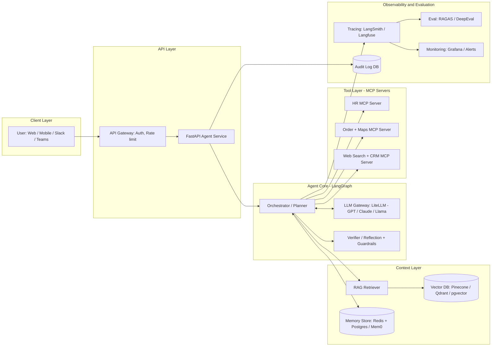

### 5.2 Layer-by-Layer Explanation

| Layer | Responsibility | Tech choices |
|-------|----------------|--------------|
| **Client** | Chat UI | React, Streamlit, Slack/Teams bot |
| **API** | Auth (who is user), rate limiting, streaming responses | FastAPI, API Gateway, JWT/OAuth, SSE/WebSockets |
| **Agent Core** | Plan → act → verify loop, state handling | LangGraph / CrewAI / OpenAI Agents SDK |
| **LLM Gateway** | One interface to many models, fallback, caching | LiteLLM, Azure OpenAI, Bedrock |
| **Context** | Documents (RAG) + memory | Vector DB, Redis, Postgres, Mem0 |
| **Tools** | Real-world actions via standard interface | MCP servers, REST APIs |
| **Observability** | Traces, audit, eval, alerts | LangSmith, Langfuse, OpenTelemetry, Grafana |

### 5.3 RAG Ingestion Pipeline (Offline)

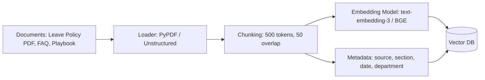

### 5.4 Non-Functional Design Points (Interview Gold)

| Concern | Solution |
|---------|----------|
| **Latency** | Streaming, parallel tool calls, small model for routing, caching (semantic cache) |
| **Cost** | Model routing, prompt caching, limit iterations, summarize long history |
| **Reliability** | Retries with backoff, timeouts, fallback model, idempotency keys |
| **Security** | Least-privilege tools, HITL for risky actions, prompt-injection defense, PII masking, RBAC on documents |
| **Scalability** | Stateless API + state in Redis/Postgres checkpointer, queue (Celery/Kafka) for long tasks |
| **Explainability** | Citations, audit trail, trace per request |

---

## 6. UML Diagrams

### 6.1 Use Case Diagram

> Mermaid has no native use-case diagram, so it is drawn as a flowchart: actors on the left, use cases in the middle, external systems on the right.

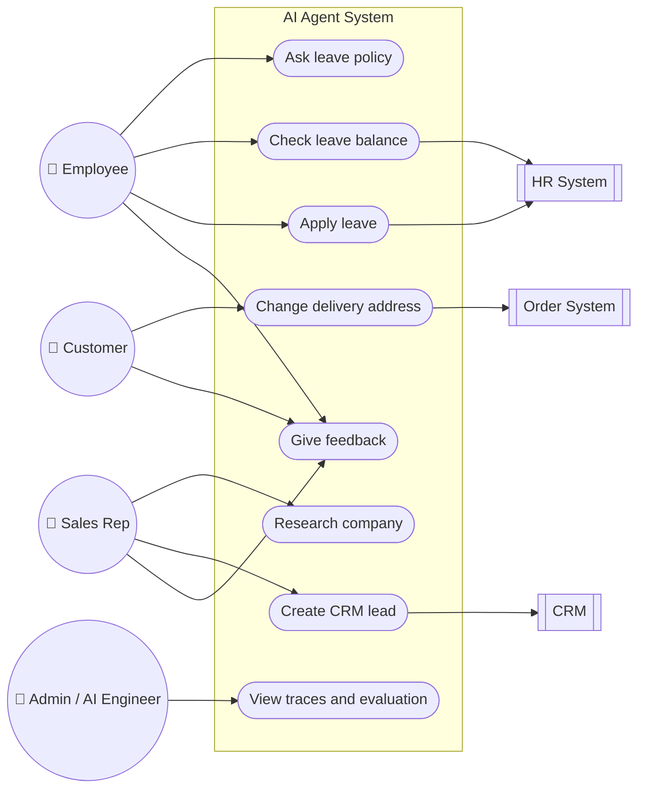

### 6.2 Activity Diagram (Agent Loop)

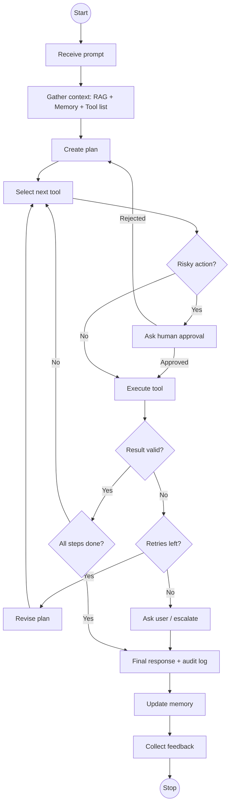

### 6.3 Sequence Diagram: E1 HR Leave Policy Assistant

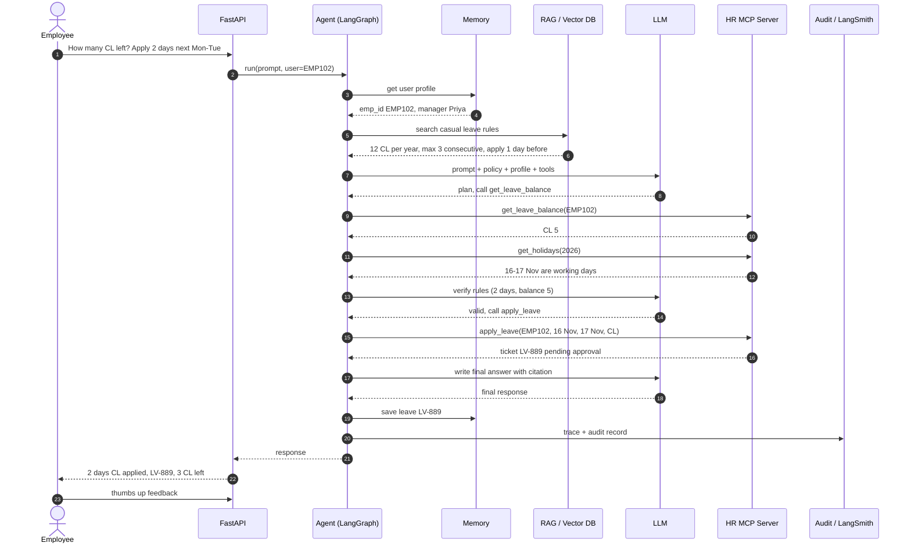

### 6.4 Sequence Diagram: E2 Delivery Address Change (with Replan)

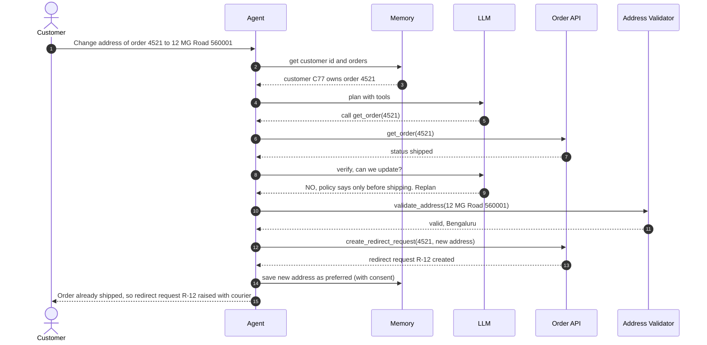

### 6.5 Sequence Diagram: E3 Company Lookup to CRM (with Reflection)

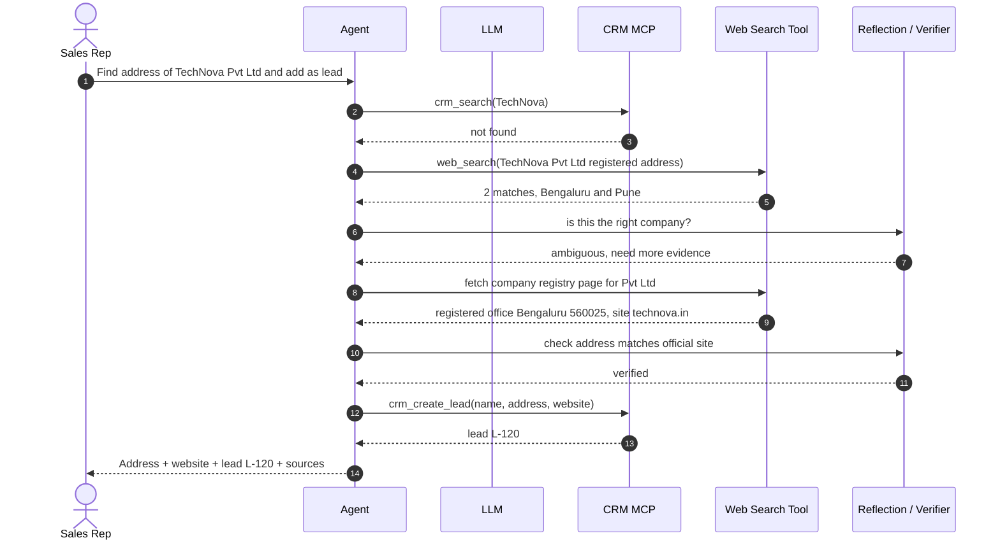

### 6.6 State Diagram (Agent Lifecycle)

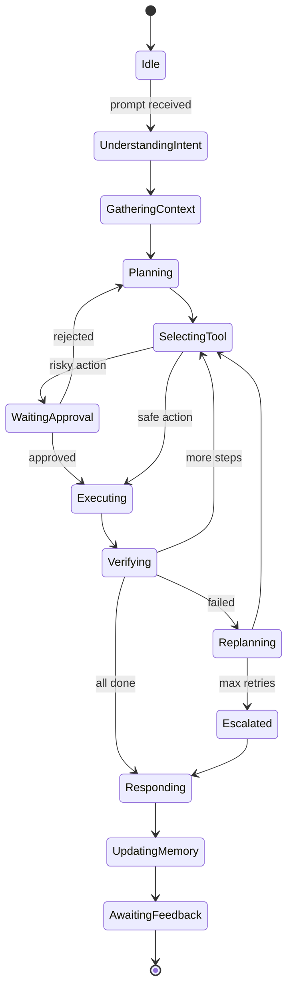

### 6.7 Class Diagram (Main Building Blocks)

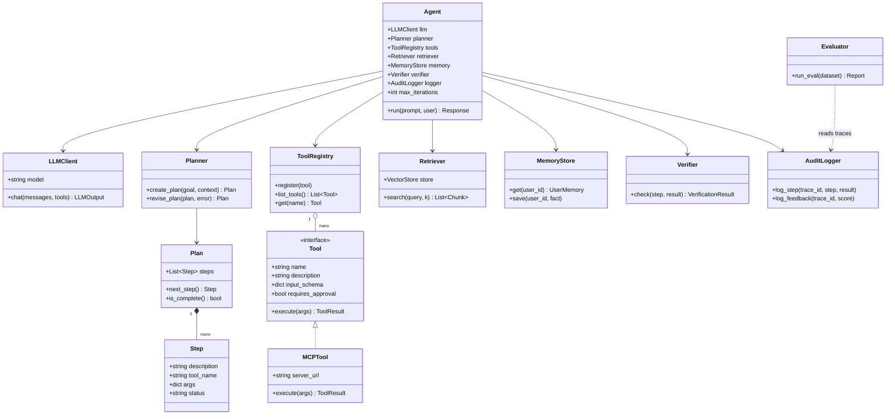

### 6.8 Deployment Diagram

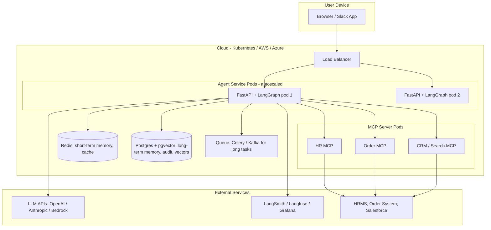

### 6.9 Data Model (ER Diagram for Memory, Audit and Feedback)

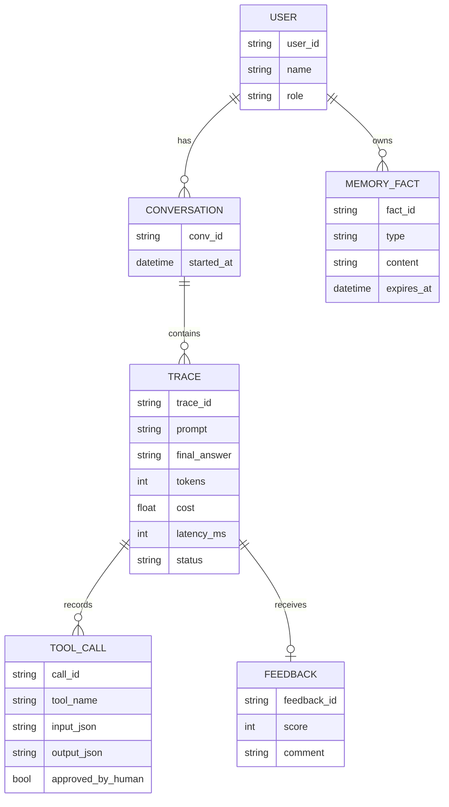

---

## 7. Minimal Code: The Agent Loop (Framework-Free Pseudocode)

```python
def run_agent(prompt, user_id, max_iters=5):
    trace = audit.start(user_id, prompt)                     # 10. audit

    memory  = memory_store.get(user_id)                      # 3b. memory retrieval
    docs    = retriever.search(prompt, k=4)                  # 3a. RAG
    tools   = tool_registry.list_tools()                     # 3c. tools / MCP

    messages = build_prompt(SYSTEM_PROMPT, prompt, memory, docs)   # 1 + 3

    for i in range(max_iters):                               # 4-9. agent loop
        out = llm.chat(messages, tools=tools)                # 2. LLM: plan + 5. tool selection

        if out.is_final_answer:                              # 9. task completion
            break

        tool = tool_registry.get(out.tool_name)
        if tool.requires_approval and not human_approves(out):   # HITL
            messages.append(observation("User rejected this action"))
            continue

        result = safe_execute(tool, out.args)                # 6. action execution
        audit.log_step(trace, out, result)

        check = verifier.check(out, result)                  # 7. verification / reflection
        messages.append(observation(result, check))          # 8. if check failed, LLM replans next turn
    else:
        out = escalate_to_human(prompt)                      # max iterations reached

    memory_store.save(user_id, extract_facts(messages))      # 11. memory update
    audit.finish(trace, out.answer)                          # 10. final response + audit
    return out.answer                                        # 12-13. feedback + eval happen on this trace
```

### Same Flow in LangGraph (Real Framework, Simplified)

```python
from langgraph.graph import StateGraph, MessagesState, START, END
from langgraph.prebuilt import ToolNode, tools_condition
from langchain_openai import ChatOpenAI

tools = [get_leave_balance, get_holidays, apply_leave, search_leave_policy]
llm = ChatOpenAI(model="gpt-4o").bind_tools(tools)

def agent(state: MessagesState):
    return {"messages": [llm.invoke(state["messages"])]}

graph = StateGraph(MessagesState)
graph.add_node("agent", agent)
graph.add_node("tools", ToolNode(tools))
graph.add_edge(START, "agent")
graph.add_conditional_edges("agent", tools_condition)   # tool call → "tools", else → END
graph.add_edge("tools", "agent")                        # loop back: observe → re-plan
app = graph.compile(checkpointer=memory_saver)          # short-term memory per thread

app.invoke({"messages": [("user", "Apply 2 days CL next Monday")]},
           config={"configurable": {"thread_id": "EMP102"}})
```

---

## 8. Framework Cheat Sheet

| Framework | Best for | One-liner |
|-----------|----------|-----------|
| **LangChain** | Building blocks (prompts, tools, retrievers) | The "toolbox" |
| **LangGraph** | Production agents, loops, HITL, state | Agent = graph/state machine |
| **LlamaIndex** | RAG-heavy apps, data connectors | Best for "chat with your data" |
| **CrewAI** | Role-based multi-agent teams | "Researcher + Writer + Reviewer" crew |
| **AutoGen / AG2** | Agents talking to each other | Conversational multi-agent |
| **OpenAI Agents SDK** | Agents with handoffs, guardrails | Lightweight, OpenAI-native |
| **Claude Agent SDK** | Agents built on Claude Code's harness | Tools, MCP, subagents built in |
| **Google ADK** | Agents on Gemini / Vertex | Google ecosystem |
| **Semantic Kernel** | .NET/enterprise apps | Microsoft ecosystem |
| **Pydantic AI** | Type-safe agents in Python | FastAPI-style DX |
| **MCP** | Standard tool/data connections | USB-C for AI tools |
| **LangSmith / Langfuse** | Tracing, eval, prompt mgmt | Observability |
| **RAGAS / DeepEval** | Evaluating RAG/agents | Testing |

---

## 9. Quick Interview Answers

**Q: What is the difference between a chatbot, RAG app, and an agent?**
- **Chatbot:** LLM answers from its training.
- **RAG app:** LLM answers from your documents (retrieve → generate). One pass, no actions.
- **Agent:** LLM **decides and acts** in a loop: plans, calls tools, verifies, replans, and remembers.

**Q: Explain the agent flow in one breath.**
> "The user prompt goes to the LLM, which gathers context through RAG, memory and the available tools/MCP. It makes a plan, selects a tool, executes it, then verifies or reflects on the result. If it fails, it revises the plan; when done, it gives a final response with an audit log, updates memory, collects feedback, and we evaluate and monitor it to keep improving."

**Q: How do you stop an agent from looping forever?**
Max iterations, timeouts, cost budget, clear stop conditions, and escalation to a human.

**Q: How do you make agents safe?**
Least-privilege tools, human approval for risky actions, guardrails on input and output, prompt-injection defense (never trust tool/web content as instructions), PII masking, audit logs.

**Q: What is MCP and why use it?**
An open protocol to connect tools/data to any LLM app in a standard way. Build once, use in many clients; separates tool logic from agent logic.

**Q: How do you evaluate an agent?**
Golden test set + metrics: task success rate, tool-call accuracy, faithfulness, context precision/recall, latency, cost, safety. Tools: RAGAS, DeepEval, LangSmith. Plus production monitoring and user feedback.

---

## 10. 30-Second Revision Card

```
PROMPT → LLM → CONTEXT (RAG + MEMORY + TOOLS/MCP) → PLAN → SELECT TOOL → EXECUTE
       → VERIFY/REFLECT → (fail? REPLAN) → COMPLETE → RESPOND + AUDIT
       → MEMORY UPDATE → FEEDBACK → EVAL / MONITOR / IMPROVE  (loop back)

E1 Leave:   RAG policy → HR balance → rules check → apply leave → LV-889
E2 Address: memory customer → get order → shipped? → replan redirect → R-12
E3 Company: CRM dedupe → web search → ambiguous! reflect → registry → lead L-120

Stack: LLM (GPT/Claude/Llama) + LangGraph + Vector DB (Qdrant/pgvector)
     + Memory (Redis/Mem0) + MCP tools + FastAPI + LangSmith/Langfuse + RAGAS/DeepEval
```
